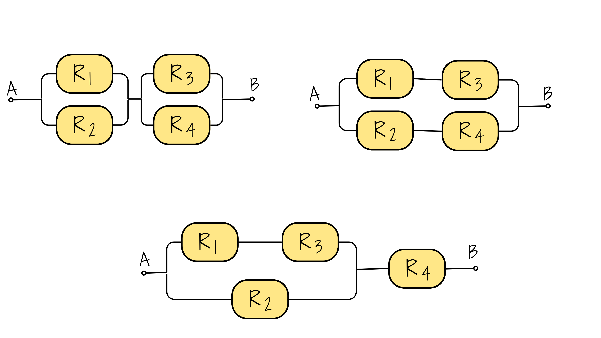
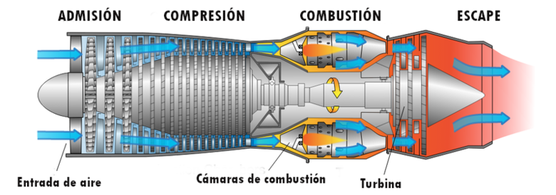

```{r setup, include=FALSE}
options(htmltools.dir.version = FALSE)
knitr::opts_chunk$set(
  fig.width=9, fig.height=3.5, fig.retina=3,
  out.width = "100%",
  cache = FALSE,
  echo = TRUE,
  message = FALSE, 
  warning = FALSE,
  hiline = TRUE
)
# colores
source("R/init.R")

paleta4=c(c11,c21,c31,c41)


library(forcats)
library(patchwork)
library(lubridate)
library(ggplot2)
library(gridExtra)
library(cowplot)
library(summarytools)

#library(dviz.supp)
```


</br></br></br>

```{r, echo=FALSE, out.width="100%", fig.align = "left"}
# nitr::
```
</br></br></br>

# Problemas de simulación

Las pistas y el código de apoyo están ocultos inicialmente. Pulse cada botón para mostrarlos u ocultarlos. El código se presenta para ejecutarlo en R; no se ejecuta al compilar el taller.


<br/><br/>

<div class="box5 with-label">

### Problema 1

En un centro de atención de una empresa de servicios, una ingeniera industrial compara dos módulos. En cada módulo se observan 100 clientes. Cada cliente tiene una probabilidad de requerir una segunda atención de $0.03$ en el módulo 1 y de $0.05$ en el módulo 2. Suponga independencia entre clientes y entre módulos; cada segunda atención genera un nuevo ingreso a la fila.

a. Sea $X$ el número de clientes que requieren una segunda atención en el módulo 1 y $Y$ el correspondiente al módulo 2. ¿Cuáles son sus distribuciones?
b. Genere 1000 réplicas independientes de los dos grupos de 100 clientes.
c. Estime la probabilidad de que el número total de clientes que requieren una segunda atención sea menor que diez.
d. Estime la probabilidad de que el módulo 1 registre más clientes con segunda atención que el módulo 2.
e. Construya una gráfica de probabilidad normal para el total de segundas atenciones. ¿Es razonable aproximarlo mediante una distribución normal? ¿Qué implicaciones tiene este reproceso sobre la demanda de atención?


<div class="botones-ayuda" style="--modulo-color: var(--c51, #79C45A);">
<details class="boton-pista">
<summary>Pista</summary>
<div class="contenido">

Use dos binomiales con n=100 y probabilidades distintas. Cada posición de los vectores representa una réplica conjunta. Las medias de condiciones lógicas estiman probabilidades.

</div>
</details>
<details class="boton-codigos">
<summary>Código R</summary>
<div class="contenido">

Ejecute los incisos en orden dentro de cada problema: los posteriores utilizan objetos creados en los anteriores. En `apply()`, `MARGIN = 1` recorre filas y `MARGIN = 2` recorre columnas. `as.numeric()` convierte indicadores lógicos en 0/1 o retira etiquetas de cuantiles.


**a. Distribuciones de X y Y**

```{r apoyo-1-a, eval=FALSE, echo=TRUE}
# Paso 1: identificar 100 ensayos independientes en cada módulo.
n_clientes <- 100
p1 <- 0.03
p2 <- 0.05
# Paso 2: X ~ Binomial(100, 0.03); Y ~ Binomial(100, 0.05).
# X e Y son independientes por el supuesto del enunciado.
```


**b. Simular los dos módulos**

```{r apoyo-1-b, eval=FALSE, echo=TRUE}
# Paso 1: fijar la semilla y el número de réplicas.
set.seed(44101)
B <- 1000
# Paso 2: cada fila representa una réplica; cada columna, un módulo.
atenciones <- cbind(X = rbinom(B, n_clientes, p1),
                    Y = rbinom(B, n_clientes, p2))
head(atenciones)
```


**c. Probabilidad de menos de diez segundas atenciones**

```{r apoyo-1-c, eval=FALSE, echo=TRUE}
# Paso 1: sumar los dos módulos por fila (MARGIN = 1).
total <- apply(atenciones, 1, sum)
# Paso 2: convertir TRUE/FALSE en 1/0; el promedio estima la probabilidad.
indicador <- as.numeric(total < 10)
mean(indicador)
```


**d. Comparar los módulos**

```{r apoyo-1-d, eval=FALSE, echo=TRUE}
# Paso 1: comparar X e Y dentro de cada réplica.
indicador <- apply(atenciones, 1, function(fila) {
  as.numeric(fila["X"] > fila["Y"])
})
# Paso 2: promediar los indicadores de X > Y.
mean(indicador)
```


**e. Gráfica normal e interpretación**

```{r apoyo-1-e, eval=FALSE, echo=TRUE}
# Paso 1: comparar los cuantiles del total con cuantiles normales.
qqnorm(total, main = "Total de segundas atenciones")
qqline(total, col = 2)
# Paso 2: buscar curvatura sistemática; la variable es discreta y puede ser sesgada.
# Paso 3: resumir la demanda adicional; no equivale a medir espera en la fila.
mean(total)
```


</div>
</details>
</div>

</div>

<br/><br/><br/><br/>


<div class="box5 with-label">

### Problema 2

La edad de una antigua pieza de materia orgánica se puede estimar a partir de la tasa a la que emite partículas beta como resultado del decaimiento del carbono-14. Por ejemplo , si X es el número de partículas emitidas durante diez minutos por un fragmento óseo con 10000 años de antigüedad  que contiene 1 g de carbono, entonces X tiene una distribución de Poisson con media $\lambda=45.62$ . Un arqueólogo descubrió un pequeño fragmento óseo que contiene 1 g de carbono. Si t es la edad desconocida del hueso, en años, el arqueólogo contar{a el número X de partículas emitidas en diez minutos y calculará una edad estimada $\widehat{t}$ con la fórmula:
	
$$\widehat{t}=\dfrac{\ln 15.3 - \ln (X/10)}{0.0001210} $$ 
	
El arqueólogo no lo sabe, pero el hueso tiene exactamente $10000$ años de antigüedad, por lo que $X$ tiene una distribución de Poisson con $\lambda=45.62$.
	
<br/>
	
```{r, echo=FALSE, out.width="30%", fig.align = "center"}
# 
```
	
<br/>

a. Genere una muestra simulada de 10000 valores de $X$ y sus correspondientes valores de $\widehat{t}$.
b. Estime la media de $\widehat{t}$.
c. Estime la desviación estándar de $\widehat{t}$.
d. Estime la probabilidad de que $\widehat{t}$ esté a 1000 años con una edad real de 10000 años.
	


<div class="botones-ayuda" style="--modulo-color: var(--c51, #79C45A);">
<details class="boton-pista">
<summary>Pista</summary>
<div class="contenido">

Genere X con rpois(). Aplique la transformación a cada réplica. Interprete el inciso d como $P(|\widehat{t}-10000|\leq1000)$. Si X=0, la edad estimada es infinita: no elimine esos casos sin advertirlo.

</div>
</details>
<details class="boton-codigos">
<summary>Código R</summary>
<div class="contenido">

Ejecute los incisos en orden dentro de cada problema: los posteriores utilizan objetos creados en los anteriores. En `apply()`, `MARGIN = 1` recorre filas y `MARGIN = 2` recorre columnas. `as.numeric()` convierte indicadores lógicos en 0/1 o retira etiquetas de cuantiles.


**a. Simular emisiones y estimar edades**

```{r apoyo-2-a, eval=FALSE, echo=TRUE}
# Paso 1: simular el número de partículas emitidas en diez minutos.
set.seed(44102)
X <- rpois(10000, lambda = 45.62)
# Paso 2: transformar cada conteo en una edad estimada (log natural).
t_est <- (log(15.3) - log(X / 10)) / 0.0001210
# Paso 3: advertir si X = 0, caso que produce una edad infinita.
sum(as.numeric(X == 0))
```


**b. Media de la edad estimada**

```{r apoyo-2-b, eval=FALSE, echo=TRUE}
# Paso 1: calcular la media sin eliminar observaciones.
mean(t_est)
# Paso 2: si hay edades infinitas, la media muestral será infinita.
# No confundir la media de esta muestra con una esperanza teórica finita.
```


**c. Desviación estándar de la edad estimada**

```{r apoyo-2-c, eval=FALSE, echo=TRUE}
# Paso 1: comprobar que todas las edades sean finitas.
if (all(is.finite(t_est))) {
  # Paso 2: calcular la desviación estándar muestral, en años.
  print(sd(t_est))
} else {
  message("La desviación estándar usual no está definida con edades infinitas.")
}
```


**d. Probabilidad de un error máximo de 1000 años**

```{r apoyo-2-d, eval=FALSE, echo=TRUE}
# Paso 1: calcular el error absoluto respecto a 10000 años.
error <- abs(t_est - 10000)
# Paso 2: usar 1 si el error es de máximo 1000 años; 0 en otro caso.
indicador <- as.numeric(error <= 1000)
# Paso 3: el promedio estima la probabilidad solicitada.
mean(indicador)
```


</div>
</details>
</div>

</div>
	

<br/><br/><br/><br/>
	
<div class="box5 with-label">

### Problema 3
	
Tres sistemas están compuestos por los componentes `R1`,`R2`, `R3` y `R4` conectados,  como lo muestra las siguientes figuras. El tiempo de vida en meses de los componentes `R1` y `R3` sigue una distribución lognormal con $\mu=2$ y $\sigma=1$ y la distribución en meses de los componentes `R2` y `R4` una distribución lognormal con $\mu=1$ y $\sigma=0.1$. El sistema solo funciona si `A` y `B` lo hacen.
	
<br/>
	
```{r, echo=FALSE, out.width="40%", fig.align = "center"}
# 
```
	
<br/>
	
a. Genere por simulación un gran número  (al menos $1000$) de los tiempos de vida de los sistemas
b. Estime la media del tiempo de vida para cada sistema.
c. Estime la probabilidad de que los sistemas fallen en un tiempo inferior a dos meses.
d. Estime el $20^{o}$ percentil ($P_{20}$) de los tiempos de vida del primer sistema .
e. Construya una gráfica de probabilidad normal de los tiempo de vida para cada sistema. ¿Los tiempos de vida de los sistemas tienen una distribución aproximadamente normal?
f. Construya un histograma de los tiempos de vida de los sistemas. ¿Están sesgados a la izquierda, sesgados a la derecha, o son aproximadamente simétricos?


<div class="botones-ayuda" style="--modulo-color: var(--c51, #79C45A);">
<details class="boton-pista">
<summary>Pista</summary>
<div class="contenido">

En R, meanlog y sdlog son los parámetros de la normal del logaritmo. En una conexión en serie se usa el mínimo; en paralelo, el máximo. La figura está comentada en el archivo: recupérela antes de definir los tres sistemas. La independencia entre componentes sería un supuesto adicional que debe discutirse.

</div>
</details>
<details class="boton-codigos">
<summary>Código R</summary>
<div class="contenido">

Ejecute los incisos en orden dentro de cada problema: los posteriores utilizan objetos creados en los anteriores. En `apply()`, `MARGIN = 1` recorre filas y `MARGIN = 2` recorre columnas. `as.numeric()` convierte indicadores lógicos en 0/1 o retira etiquetas de cuantiles.


**Requisito del problema 3:** recuperar la figura y completar las conexiones de los sistemas en el inciso a antes de ejecutar b–f.


**a. Simular componentes y definir conexiones**

```{r apoyo-3-a, eval=FALSE, echo=TRUE}
# Paso 1: generar componentes; aquí se añade el supuesto de independencia.
set.seed(44103)
n <- 10000
componentes <- cbind(R1 = rlnorm(n, 2, 1), R2 = rlnorm(n, 1, 0.1),
                     R3 = rlnorm(n, 2, 1), R4 = rlnorm(n, 1, 0.1))
# meanlog y sdlog parametrizan el logaritmo del tiempo de vida.
# Paso 2: definir operaciones por fila: serie = mínimo; paralelo = máximo.
serie <- function(matriz) apply(matriz, 1, min)
paralelo <- function(matriz) apply(matriz, 1, max)
# Paso 3: recuperar la figura y definir T1, T2 y T3 según sus conexiones.
# Ejemplo de operación, sin atribuirla a ninguno de los sistemas:
# paralelo(componentes[, c("R1", "R2")])
# Paso 4: SOLO después de definirlos, descomentar:
# sistemas <- cbind(Sistema1 = T1, Sistema2 = T2, Sistema3 = T3)
```


**b. Vida media de cada sistema**

```{r apoyo-3-b, eval=FALSE, echo=TRUE}
# Requisito: crear la matriz sistemas del inciso a con las conexiones reales.
# Paso 1: recorrer las columnas (MARGIN = 2), una por sistema.
# Paso 2: obtener la media de cada columna, en meses.
apply(sistemas, 2, mean)
```


**c. Falla antes de dos meses**

```{r apoyo-3-c, eval=FALSE, echo=TRUE}
# Paso 1: convertir los eventos de falla de cada columna en indicadores 0/1.
# Paso 2: promediarlos por sistema.
apply(sistemas, 2, function(tiempo) mean(as.numeric(tiempo < 2)))
```


**d. Percentil 20 del primer sistema**

```{r apoyo-3-d, eval=FALSE, echo=TRUE}
# Paso 1: seleccionar los tiempos del primer sistema.
# Paso 2: obtener el cuantil 0.20 y retirar su etiqueta con as.numeric().
P20 <- as.numeric(quantile(sistemas[, "Sistema1"], probs = 0.20))
P20
# Aproximadamente 20% de las vidas simuladas no supera este valor.
```


**e. Gráficas de probabilidad normal**

```{r apoyo-3-e, eval=FALSE, echo=TRUE}
# Paso 1: guardar la configuración gráfica y disponer tres paneles.
op <- par(mfrow = c(1, 3))
# Paso 2: apply() recorre las columnas y dibuja cada gráfico normal.
invisible(apply(sistemas, 2, function(tiempo) {
  qqnorm(tiempo, main = "Evaluación de normalidad")
  qqline(tiempo, col = 2)
}))
# Paso 3: restaurar los gráficos; evaluar curvaturas, en especial en las colas.
par(op)
# Los paneles siguen el orden de las columnas de sistemas.
```


**f. Histogramas de vida útil**

```{r apoyo-3-f, eval=FALSE, echo=TRUE}
# Paso 1: disponer un panel por sistema, en el orden de las columnas.
op <- par(mfrow = c(1, 3))
# Paso 2: construir el histograma de cada columna con apply().
invisible(apply(sistemas, 2, function(tiempo) {
  hist(tiempo, breaks = 30, main = "Vida del sistema", xlab = "Meses")
}))
# Paso 3: restaurar y comparar la extensión de las colas para describir el sesgo.
par(op)
```


</div>
</details>
</div>

</div>
	
<br/><br/><br/><br/>
	
<div class="box5 with-label">

### Problema 4  
	
Estimación del valor de $\pi$ . LA siguiente figura sugiere como estimar el valor de $\pi$ con una simulación. En la figura, un círculo con área igual a $\pi/4$, está inscrito en un cuadrado cuya área es igual a 1. Se elige de forma aleatoria 100 puntos dentro del cuadrado . La probabilidad de que un punto esté dentro del círculo es igual a la fracción del área del cuadrado que abarca a este, la cual es $\pi/4$. Por tanto, se puede estimar el valor de $\pi/4$ al contar el número de puntos dentro del círculo, que es 79 para obtener la estimación de $\pi/4 \approx 0.76$ . De este último resultado se concluye que $\pi \approx 4(0.79) =3.14$ . Este ejercicio presenta un experimento de simulación que fue diseñado para estimar el valor de $\pi$ al generar 1000 puntos en el cuadrado.
	
<br/>
	
```{r, echo=FALSE, out.width="40%", fig.align = "center"}
# knitr::include_graphics("img/fig_pi.png")
```
	
<br/>
	
a. Genere 1000 coordenadas $x$:  $X_{1}$, . . . , $X_{1000}$. Utilice la distribución uniforme con valor mínimo de $0$ y valor máximo de $1$. La distribución uniforme genera variables aleatorias que tienen la misma probabilidad de venir de cualquier parte del intervalo $(0, 1)$.
	
b. Genere $1000$ coordenadas $y$ : $Y_{1}, . . . , Y_{1000}$, utilizando nuevamente la distribución uniforme con valor mínimo de $0$ y valor máximo de $1$.
	
c. Cada punto $(X_{i},Y_{i})$ se encuentra dentro del círculo si su distancia desde el centro $(0.5, 0.5)$ es menor a $0.5$. Para cada par $(X_{i},Y_{i})$ determine si la distancia desde el centro es menor a $0.5$. Esto último se puede realizar al calcular el valor $(X_{i}-0.5)^{2}+(Y_{i}-0.5)^{2}$, que es el cuadrado de la distancia, y al determinar si es menor que $0.25$.
	
d. ¿Cuántos de los puntos están dentro del círculo? ¿Cuál es su estimación de $\pi$? (Nota: Con sólo 1000 puntos, es probable que su estimación sea inferior por 0.05 o más. Una simulación con 10000 y 100000 puntos tiene mayores probabilidades de dar como resultado una estimación muy cercana al valor verdadero
	


<div class="botones-ayuda" style="--modulo-color: var(--c51, #79C45A);">
<details class="boton-pista">
<summary>Pista</summary>
<div class="contenido">

Simule dos uniformes independientes y use el indicador de pertenencia al círculo. Multiplique su promedio por cuatro. Nota sobre el enunciado conservado: 79/100=0.79 y 4(0.79)=3.16; aparecen inconsistencias aritméticas en el texto original.

</div>
</details>
<details class="boton-codigos">
<summary>Código R</summary>
<div class="contenido">

Ejecute los incisos en orden dentro de cada problema: los posteriores utilizan objetos creados en los anteriores. En `apply()`, `MARGIN = 1` recorre filas y `MARGIN = 2` recorre columnas. `as.numeric()` convierte indicadores lógicos en 0/1 o retira etiquetas de cuantiles.


**a. Simular coordenadas x**

```{r apoyo-4-a, eval=FALSE, echo=TRUE}
# Paso 1: fijar la semilla y el número de puntos.
set.seed(44104)
n <- 1000
# Paso 2: simular coordenadas uniformes en el intervalo (0, 1).
x <- runif(n, min = 0, max = 1)
```


**b. Simular coordenadas y**

```{r apoyo-4-b, eval=FALSE, echo=TRUE}
# Paso 1: generar nuevas uniformes independientes de las anteriores.
y <- runif(n, min = 0, max = 1)
# Paso 2: organizar una pareja de coordenadas por fila.
puntos <- cbind(x = x, y = y)
```


**c. Identificar puntos dentro del círculo**

```{r apoyo-4-c, eval=FALSE, echo=TRUE}
# Paso 1: calcular la distancia al cuadrado por fila con apply().
distancia2 <- apply(puntos, 1, function(punto) sum((punto - 0.5)^2))
# Paso 2: convertir la condición de pertenencia en un indicador 0/1.
dentro <- as.numeric(distancia2 < 0.25)
```


**d. Contar puntos y estimar pi**

```{r apoyo-4-d, eval=FALSE, echo=TRUE}
# Paso 1: sumar los indicadores para contar los puntos interiores.
sum(dentro)
# Paso 2: estimar pi como cuatro veces la proporción interior.
pi_estimado <- 4 * mean(dentro)
pi_estimado
# Paso 3: visualizar el resultado; asp = 1 conserva la geometría.
plot(puntos, col = ifelse(dentro == 1, "#7A6DB2", "#B8D7E8"),
     pch = 16, asp = 1, main = "Estimación de pi")
```


</div>
</details>
</div>

</div>
	
<br/>
	
Ejercicios tomados de Navidi(2006)
	
<br/><br/><br/>

<div class="box5 with-label">

### Problema 5 
	
Una planta de manufactura produce pistones para motores de combustión interna. El diámetro de los pistones debe ser de 10 cm, pero debido a variaciones en el proceso de producción, sigue una distribución normal con media $\mu = 10$ cm y desviación estándar $\sigma = 0.02$ cm. Un pistón es rechazado si su diámetro está fuera del rango de 9.97 cm a 10.03 cm.
	
```{r, echo=FALSE, out.width="40%", fig.align = "center"}
# knitr::include_graphics("img/piston.png")
```
	
a. Genere una muestra simulada de 5000 pistones.
b. Estime la proporción de pistones rechazados por no cumplir con las especificaciones.
c. Si el costo de reprocesamiento de un pistón defectuoso es de $15 USD, estime el costo promedio de reprocesamiento por cada 5000 pistones fabricados.
d. Genere un histograma del diámetro de los pistones y evalúe si se ajusta a la distribución normal.
e. ¿Qué estrategias podrían implementarse para reducir el número de pistones rechazados?


<div class="botones-ayuda" style="--modulo-color: var(--c51, #79C45A);">
<details class="boton-pista">
<summary>Pista</summary>
<div class="contenido">

El rechazo ocurre en cualquiera de las dos colas. Para un lote, el costo es 15 por el número de rechazos; el costo esperado puede estimarse como 5000 por la proporción de rechazo por 15.

</div>
</details>
<details class="boton-codigos">
<summary>Código R</summary>
<div class="contenido">

Ejecute los incisos en orden dentro de cada problema: los posteriores utilizan objetos creados en los anteriores. En `apply()`, `MARGIN = 1` recorre filas y `MARGIN = 2` recorre columnas. `as.numeric()` convierte indicadores lógicos en 0/1 o retira etiquetas de cuantiles.


**a. Simular diámetros**

```{r apoyo-5-a, eval=FALSE, echo=TRUE}
# Paso 1: fijar la semilla y el tamaño del lote.
set.seed(44105)
n <- 5000
# Paso 2: simular los diámetros, medidos en centímetros.
diametro <- rnorm(n, mean = 10, sd = 0.02)
```


**b. Estimar la proporción rechazada**

```{r apoyo-5-b, eval=FALSE, echo=TRUE}
# Paso 1: identificar el incumplimiento en cualquiera de las dos colas.
rechazo <- as.numeric(diametro < 9.97 | diametro > 10.03)
# Paso 2: promediar los indicadores 0/1.
proporcion_rechazo <- mean(rechazo)
proporcion_rechazo
```


**c. Estimar el costo por lote**

```{r apoyo-5-c, eval=FALSE, echo=TRUE}
# Paso 1: multiplicar cada indicador por el costo de reprocesar un pistón.
costo_por_piston <- 15 * rechazo
# Paso 2: sumar para obtener el costo del lote simulado de 5000 pistones.
sum(costo_por_piston)
# Paso 3: estimar el costo esperado por lote usando la proporción simulada.
n * proporcion_rechazo * 15
# Para este lote ambos cálculos coinciden.
```


**d. Histograma y comparación normal**

```{r apoyo-5-d, eval=FALSE, echo=TRUE}
# Paso 1: usar escala de densidad para poder superponer la curva normal.
hist(diametro, probability = TRUE, breaks = 30,
     main = "Diámetro de los pistones", xlab = "cm")
# Paso 2: agregar la densidad teórica del modelo generador.
curve(dnorm(x, mean = 10, sd = 0.02), add = TRUE, col = 2, lwd = 2)
# La coincidencia es esperable: los datos fueron generados con ese modelo.
```


**e. Evaluar una mejora del proceso**

```{r apoyo-5-e, eval=FALSE, echo=TRUE}
# Paso 1: considerar, como escenario adicional, reducir sigma a 0.015 cm.
# Paso 2: comparar probabilidades teóricas de rechazo manteniendo la media.
sigmas <- c(actual = 0.02, mejora = 0.015)
escenarios <- matrix(sigmas, ncol = 1,
                     dimnames = list(names(sigmas), "sigma"))
apply(escenarios, 1, function(fila) {
  pnorm(9.97, 10, fila[1]) + 1 - pnorm(10.03, 10, fila[1])
})
# Paso 3: discutir calibración, mantenimiento y reducción de variabilidad.
# La mejora hipotética requiere validación con datos reales.
```


</div>
</details>
</div>

</div>

<br/><br/><br/><br/>

<div class="box5 with-label">

### Problema 6

En un centro de atención llegan en promedio 30 clientes por minuto durante una franja de alta demanda. El número de llegadas en cada minuto sigue una distribución de Poisson con $\lambda=30$ y las llegadas en minutos distintos son independientes. El conjunto de puestos puede atender hasta 35 clientes por minuto. Para un modelo simplificado por intervalos, suponga que los clientes no atendidos permanecen en una fila única, la fila comienza vacía y la capacidad se aplica después de las llegadas de cada minuto.

a. Simule las llegadas durante 10000 minutos.
b. Estime la probabilidad de que lleguen más de 40 clientes en un minuto.
c. Estime la proporción de minutos en que las llegadas superan la capacidad de 35. Calcule además la fila al final de cada minuto usando $Q_t=\max(0,Q_{t-1}+A_t-35)$, con $Q_0=0$, y estime su longitud promedio y máxima.
d. Repita el cálculo de la fila con capacidad de 40 clientes por minuto y compare. ¿Qué decisiones sobre capacidad y turnos recomendaría?
e. Construya un histograma de llegadas por minuto y una gráfica de la fila a lo largo del tiempo. Distinga entre exceso de llegadas en un minuto y acumulación de clientes en la fila.


<div class="botones-ayuda" style="--modulo-color: var(--c51, #79C45A);">
<details class="boton-pista">
<summary>Pista</summary>
<div class="contenido">

rpois() simula llegadas, no tiempos de espera. Actualice la fila de forma secuencial: la fila anterior se suma a las llegadas antes de restar la capacidad. Use las mismas llegadas para comparar capacidades.

</div>
</details>
<details class="boton-codigos">
<summary>Código R</summary>
<div class="contenido">

Ejecute los incisos en orden dentro de cada problema: los posteriores utilizan objetos creados en los anteriores. En `apply()`, `MARGIN = 1` recorre filas y `MARGIN = 2` recorre columnas. `as.numeric()` convierte indicadores lógicos en 0/1 o retira etiquetas de cuantiles.


**a. Simular llegadas**

```{r apoyo-6-a, eval=FALSE, echo=TRUE}
# Paso 1: fijar la semilla para comparar escenarios con iguales llegadas.
set.seed(44106)
# Paso 2: generar 10000 conteos, uno por minuto.
llegadas <- rpois(10000, lambda = 30)
```


**b. Probabilidad de más de 40 llegadas**

```{r apoyo-6-b, eval=FALSE, echo=TRUE}
# Paso 1: convertir el evento en un indicador 0/1 por minuto.
mas_40 <- as.numeric(llegadas > 40)
# Paso 2: promediar para estimar la probabilidad.
mean(mas_40)
```


**c. Exceso de demanda y fila con capacidad 35**

```{r apoyo-6-c, eval=FALSE, echo=TRUE}
# Paso 1: estimar la proporción de minutos con llegadas mayores que 35.
mean(as.numeric(llegadas > 35))
# Paso 2: definir la recurrencia; requiere orden temporal, no filas independientes.
simular_fila <- function(llegadas, capacidad) {
  fila <- numeric(length(llegadas))
  anterior <- 0
  for (t in seq_along(llegadas)) {
    # Sumar fila anterior y llegadas; restar capacidad sin permitir negativos.
    fila[t] <- max(0, anterior + llegadas[t] - capacidad)
    anterior <- fila[t]
  }
  fila
}
# Paso 3: calcular la fila y resumir su longitud al final de cada minuto.
q35 <- simular_fila(llegadas, capacidad = 35)
c(promedio = mean(q35), maxima = max(q35))
```


**d. Comparar capacidades 35 y 40**

```{r apoyo-6-d, eval=FALSE, echo=TRUE}
# Paso 1: reutilizar las mismas llegadas para la capacidad alternativa.
q40 <- simular_fila(llegadas, capacidad = 40)
filas <- cbind(Capacidad35 = q35, Capacidad40 = q40)
# Paso 2: aplicar un resumen a cada columna (MARGIN = 2).
apply(filas, 2, function(fila) {
  c(promedio = mean(fila), maxima = max(fila),
    proporcion_minutos_con_fila = mean(as.numeric(fila > 0)))
})
# Paso 3: valorar la reducción de la fila frente al costo de capacidad adicional.
```


**e. Visualizar llegadas y fila**

```{r apoyo-6-e, eval=FALSE, echo=TRUE}
# Paso 1: representar la variabilidad de llegadas por minuto.
hist(llegadas, breaks = 30, main = "Llegadas por minuto", xlab = "Clientes")
# Paso 2: representar las dos filas en orden temporal.
matplot(filas, type = "l", lty = 1, col = c("#7A6DB2", "#21B5E4"),
        xlab = "Minuto", ylab = "Clientes al final del minuto")
legend("topright", colnames(filas), col = c("#7A6DB2", "#21B5E4"), lty = 1)
# Paso 3: distinguir llegadas > capacidad de una fila heredada de minutos previos.
# Este modelo por intervalos no estima tiempos individuales de espera.
```


</div>
</details>
</div>

</div>

<br/><br/><br/><br/>

<div class="box5 with-label">

### Problema 7

Una ingeniera industrial estudia el tiempo de atención de clientes en un módulo de trámites. El tiempo de servicio sigue una distribución normal con media $\mu=30$ minutos y desviación estándar $\sigma=5$ minutos. La meta es atender al menos al 95% de los clientes en un tiempo de servicio de máximo 35 minutos. El tiempo de servicio no incluye la espera en la fila. Para esta simulación, descarte y vuelva a generar cualquier tiempo negativo.

a. Genere tiempos de servicio para 10000 clientes.
b. Estime el porcentaje atendido en máximo 35 minutos. ¿Se cumple la meta del 95%?
c. Estime el percentil 90 ($P_{90}$) del tiempo de servicio e interprételo.
d. Si cada atención que supera los 35 minutos genera un costo adicional de 50 USD, estime el costo total para los 10000 clientes y el costo promedio por cliente.
e. ¿Qué mejoras en el proceso podrían reducir el tiempo de servicio y su variabilidad? Explique por qué estos datos, por sí solos, no permiten estimar la espera en la fila.


<div class="botones-ayuda" style="--modulo-color: var(--c51, #79C45A);">
<details class="boton-pista">
<summary>Pista</summary>
<div class="contenido">

Use rnorm() y regenere los valores negativos. Un percentil es un tiempo, mientras que la proporción de cumplimiento es una probabilidad. No confunda tiempo de servicio con tiempo total en el sistema.

</div>
</details>
<details class="boton-codigos">
<summary>Código R</summary>
<div class="contenido">

Ejecute los incisos en orden dentro de cada problema: los posteriores utilizan objetos creados en los anteriores. En `apply()`, `MARGIN = 1` recorre filas y `MARGIN = 2` recorre columnas. `as.numeric()` convierte indicadores lógicos en 0/1 o retira etiquetas de cuantiles.


**a. Simular tiempos de servicio**

```{r apoyo-7-a, eval=FALSE, echo=TRUE}
# Paso 1: simular tiempos normales con semilla reproducible.
set.seed(44107)
tiempo <- rnorm(10000, mean = 30, sd = 5)
# Paso 2: regenerar únicamente los negativos hasta obtener tiempos válidos.
while (any(tiempo < 0)) {
  negativos <- tiempo < 0
  tiempo[negativos] <- rnorm(sum(as.numeric(negativos)), 30, 5)
}
# El resultado corresponde a la normal condicionada a ser no negativa.
```


**b. Cumplimiento de la meta**

```{r apoyo-7-b, eval=FALSE, echo=TRUE}
# Paso 1: construir indicadores de atención en máximo 35 minutos.
cumple <- as.numeric(tiempo <= 35)
# Paso 2: expresar la frecuencia relativa como porcentaje.
porcentaje <- 100 * mean(cumple)
porcentaje
# Paso 3: comprobar si alcanza el 95% solicitado.
porcentaje >= 95
```


**c. Percentil 90 del servicio**

```{r apoyo-7-c, eval=FALSE, echo=TRUE}
# Paso 1: calcular el percentil y convertirlo en número sin etiqueta.
P90 <- as.numeric(quantile(tiempo, probs = 0.90))
P90
# Paso 2: interpretar: aproximadamente 90% de las atenciones dura hasta P90 minutos.
```


**d. Costo total y promedio**

```{r apoyo-7-d, eval=FALSE, echo=TRUE}
# Paso 1: asignar 50 USD a cada atención que supera el límite.
costos <- 50 * as.numeric(tiempo > 35)
# Paso 2: sumar para el costo total y promediar para el costo por cliente.
c(total_USD = sum(costos), promedio_cliente_USD = mean(costos))
```


**e. Proponer mejoras e identificar datos faltantes**

```{r apoyo-7-e, eval=FALSE, echo=TRUE}
# Paso 1: resumir el nivel y la variabilidad del servicio.
resumen <- c(media_minutos = mean(tiempo), desviacion_minutos = sd(tiempo))
resumen
# Paso 2: proponer estandarización de trámites y eliminación de reprocesos.
# Paso 3: para estimar espera se necesitan llegadas, puestos disponibles,
# disciplina de la fila y condiciones iniciales, además de tiempos de servicio.
```


</div>
</details>
</div>

</div>

<br/><br/><br/><br/>

<div class="box5 with-label">

### Problema 8 

Una turbina de gas tiene cuatro componentes críticos que fallan de manera independiente. Los tiempos de vida (en horas) de cada componente siguen distribuciones exponenciales:

Componente 1: $\lambda = 1/5000$
Componente 2: $\lambda = 1/4000$
Componente 3: $\lambda = 1/6000$
Componente 4: $\lambda = 1/5500$

La turbina deja de funcionar cuando el primer componente falla.

<br/>
```{r, echo=FALSE, out.width="40%", fig.align = "center"}
# 
```
<br/>

a. Genere 5000 simulaciones del tiempo de vida de la turbina.
b. Estime la vida media de la turbina.
c. Estime la probabilidad de que la turbina falle antes de 4000 horas.
d. Construya el histograma del tiempo de vida de la turbina y comente sobre su forma.
e. ¿Qué estrategias de mantenimiento preventivo se pueden considerar?


<div class="botones-ayuda" style="--modulo-color: var(--c51, #79C45A);">
<details class="boton-pista">
<summary>Pista</summary>
<div class="contenido">

Genere cuatro exponenciales independientes por réplica. Como basta la primera falla para detener la turbina, use el mínimo. El parámetro rate es el inverso de la vida media.

</div>
</details>
<details class="boton-codigos">
<summary>Código R</summary>
<div class="contenido">

Ejecute los incisos en orden dentro de cada problema: los posteriores utilizan objetos creados en los anteriores. En `apply()`, `MARGIN = 1` recorre filas y `MARGIN = 2` recorre columnas. `as.numeric()` convierte indicadores lógicos en 0/1 o retira etiquetas de cuantiles.


**a. Simular la vida de la turbina**

```{r apoyo-8-a, eval=FALSE, echo=TRUE}
# Paso 1: generar una columna por componente; cada fila es una réplica.
set.seed(44108)
n <- 5000
componentes <- cbind(C1 = rexp(n, rate = 1/5000),
                     C2 = rexp(n, rate = 1/4000),
                     C3 = rexp(n, rate = 1/6000),
                     C4 = rexp(n, rate = 1/5500))
# Paso 2: tomar el mínimo por fila: la primera falla detiene la turbina.
T_turbina <- apply(componentes, 1, min)
```


**b. Estimar la vida media**

```{r apoyo-8-b, eval=FALSE, echo=TRUE}
# Paso 1: promediar los tiempos de vida simulados, en horas.
mean(T_turbina)
```


**c. Probabilidad de falla antes de 4000 horas**

```{r apoyo-8-c, eval=FALSE, echo=TRUE}
# Paso 1: codificar con 1 las fallas anteriores a 4000 horas y con 0 las demás.
falla <- as.numeric(T_turbina < 4000)
# Paso 2: promediar los indicadores.
mean(falla)
```


**d. Histograma de la vida útil**

```{r apoyo-8-d, eval=FALSE, echo=TRUE}
# Paso 1: representar las vidas simuladas.
hist(T_turbina, breaks = 40, main = "Vida de la turbina", xlab = "Horas")
# Paso 2: identificar la cola hacia la derecha, propia del mínimo de exponenciales.
# Bajo independencia, la tasa del sistema es la suma de las cuatro tasas.
```


**e. Discutir mantenimiento preventivo**

```{r apoyo-8-e, eval=FALSE, echo=TRUE}
# Paso 1: comparar las tasas de falla constantes de los componentes.
tasas <- c(C1 = 1/5000, C2 = 1/4000, C3 = 1/6000, C4 = 1/5500)
sort(tasas, decreasing = TRUE)
# Paso 2: priorizar monitoreo y disponibilidad de repuestos según criticidad.
# Paso 3: recordar que la exponencial no tiene memoria: un reemplazo por edad
# no reduce por sí solo la tasa constante. Evaluar costos, inspecciones,
# redundancia y si el modelo de falla representa el desgaste real.
```


</div>
</details>
</div>

</div>

<br/><br/><br/><br/>


<div class="box5 with-label">

### Problema 9

En un centro de atención, el máximo diario del tiempo de espera en la fila se modela mediante una distribución Gumbel con parámetro de localización $\mu=20$ minutos y escala $\beta=5$ minutos. Suponga independencia entre máximos de días distintos. La meta operativa establece que el máximo diario no debe superar 35 minutos. Se desea evaluar un horizonte de 30 días.

a. Genere 10000 réplicas de periodos de 30 días de máximos diarios de espera.
b. Estime la probabilidad de que, al menos un día de un periodo de 30 días, el máximo supere 35 minutos. Distíngala de la probabilidad de superar el límite en un solo día.
c. Determine el umbral de espera que tendría una probabilidad de superación de apenas 1% en todo el periodo de 30 días, bajo el modelo actual. Explique por qué este umbral describe el riesgo y no implica que sea una meta de servicio aceptable.
d. Construya un histograma de los máximos diarios y otro del máximo de cada periodo de 30 días.
e. ¿Qué medidas de capacidad, programación de personal y gestión de filas propondría para reducir los máximos de espera?


<div class="botones-ayuda" style="--modulo-color: var(--c51, #79C45A);">
<details class="boton-pista">
<summary>Pista</summary>
<div class="contenido">

La inversa Gumbel es $\mu-\beta\log(-\log U)$. Para 30 días independientes, $P(M_{30}\leq z)=F(z)^{30}$. Para el inciso c resuelva $F(z)^{30}=0.99$. El modelo permite tiempos negativos, aunque con estos parámetros su probabilidad es extremadamente pequeña; es una limitación de la aproximación.

</div>
</details>
<details class="boton-codigos">
<summary>Código R</summary>
<div class="contenido">

Ejecute los incisos en orden dentro de cada problema: los posteriores utilizan objetos creados en los anteriores. En `apply()`, `MARGIN = 1` recorre filas y `MARGIN = 2` recorre columnas. `as.numeric()` convierte indicadores lógicos en 0/1 o retira etiquetas de cuantiles.


**a. Simular periodos de 30 días**

```{r apoyo-9-a, eval=FALSE, echo=TRUE}
# Paso 1: fijar parámetros y generar uniformes independientes.
set.seed(44109)
B <- 10000
dias <- 30
mu <- 20
beta <- 5
U <- matrix(runif(B * dias), nrow = B, ncol = dias)
# Paso 2: aplicar la inversa Gumbel; cada fila es un periodo de 30 días.
maximos_diarios <- mu - beta * log(-log(U))
# Paso 3: extraer el máximo por periodo usando MARGIN = 1.
maximos_periodo <- apply(maximos_diarios, 1, max)
```


**b. Riesgo diario y riesgo del periodo**

```{r apoyo-9-b, eval=FALSE, echo=TRUE}
# Paso 1: calcular el evento de al menos una superación por fila.
indicador_periodo <- apply(maximos_diarios, 1, function(fila) {
  as.numeric(any(fila > 35))
})
# Paso 2: estimar la probabilidad por periodo y la probabilidad diaria.
p_periodo <- mean(indicador_periodo)
p_diaria <- mean(as.numeric(maximos_diarios > 35))
c(diaria = p_diaria, periodo_30_dias = p_periodo)
# Paso 3: contrastar con la expresión teórica para días independientes.
F35 <- exp(-exp(-(35 - mu) / beta))
1 - F35^dias
```


**c. Umbral con riesgo de superación de 1%**

```{r apoyo-9-c, eval=FALSE, echo=TRUE}
# Paso 1: fijar P(maximo de 30 dias <= umbral) = 0.99.
# Paso 2: despejar la CDF diaria objetivo por independencia.
p_diaria_objetivo <- 0.99^(1 / dias)
# Paso 3: aplicar la inversa Gumbel a esa probabilidad.
umbral <- mu - beta * log(-log(p_diaria_objetivo))
umbral
# Paso 4: comprobar el riesgo teórico del periodo.
F_umbral <- exp(-exp(-(umbral - mu) / beta))
1 - F_umbral^dias
# Es un umbral de riesgo del modelo actual, no una meta aceptable de servicio.
```


**d. Histogramas diarios y por periodo**

```{r apoyo-9-d, eval=FALSE, echo=TRUE}
# Paso 1: convertir la matriz en un vector para reunir los máximos diarios.
hist(as.numeric(maximos_diarios), breaks = 40,
     main = "Máximos diarios", xlab = "Minutos")
# Paso 2: representar el máximo de cada uno de los 10000 periodos.
hist(maximos_periodo, breaks = 40,
     main = "Máximos de periodos de 30 días", xlab = "Minutos")
# Paso 3: comparar la posición y la cola de ambas distribuciones.
```


**e. Proponer medidas operativas**

```{r apoyo-9-e, eval=FALSE, echo=TRUE}
# Paso 1: resumir los máximos de los periodos simulados.
c(media = mean(maximos_periodo),
  P95 = as.numeric(quantile(maximos_periodo, 0.95)))
# Paso 2: proponer refuerzos en horas pico, citas y reducción de reprocesos.
# Paso 3: medir de nuevo y recalibrar mu y beta tras los cambios.
# Este modelo de máximos no predice por sí solo el efecto de agregar puestos.
```


</div>
</details>
</div>

</div>

	
<br/><br/><br/>

