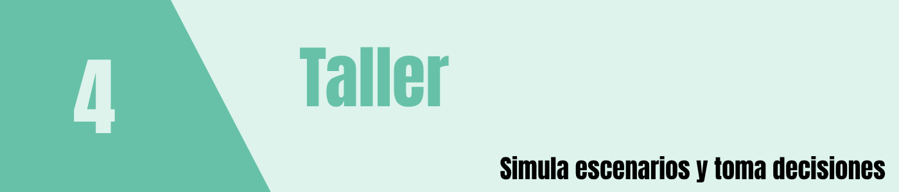

```{r setup, include=FALSE}
knitr::opts_chunk$set(echo = TRUE, warning = FALSE, message = FALSE)
```

<br/><br/><br/>

```{r encabezado, echo=FALSE, out.width="100%", fig.align="left"}
# Encabezado opcional con el estilo de actividad331.Rmd.
# Si desea usar una imagen, guárdela como img/taller3.png.
if (file.exists("img/taller4.png")) {
  
}
```

<br/><br/>

# Introducción

> **Propósito.** Construir paso a paso un prototipo de gemelo digital de una cafetería universitaria. Cada versión funciona por sí sola: copie el código indicado en un archivo `app.R` y ejecútelo. La guía se puede publicar como HTML en GitHub Pages, pero las aplicaciones Shiny requieren ejecutarse en R local o en un servidor compatible.

<br/><br/>

> **Alcance.** Primero se trabaja con un solo servidor y una fila FIFO. Los tiempos **entre llegadas** son exponenciales y los tiempos de **servicio** se generan con una normal positiva aproximada. El modelo es inicialmente una **simulación digital**; se convierte en un gemelo digital del sistema real cuando se alimenta y calibra con mediciones de la cafetería.

<br/><br/>

### Organización del taller

| Etapa | Producto | Concepto central |
|:--|:--|:--|
| Preparación | Entorno preparado | Instalación y ejecución |
| 0 | Aplicación inicial de Shiny | Reconocer el código generado automáticamente |
| 1 | Tablero mínimo | Interfaz y reactividad |
| 2 | Simulador de 20 clientes | Llegadas, servicio y espera |
| 3 | Gráficos e indicadores | Análisis de la fila |
| 4 | Escenarios comparables | Experimentación y Monte Carlo |
| 5 | Datos observados y calibración | Aproximación al gemelo digital |
| 6 | Cafetería animada | Llegadas, fila, atención y salida en tiempo simulado |

<br/><br/>

**Duración sugerida:** dos sesiones de 90 minutos para construir las etapas 1 a 3; las etapas 4, 5 y 6 son ampliaciones o trabajo autónomo. Para cada versión, conserve una copia en una carpeta distinta (`v1`, `v2`, etc.).

<br/><br/>

### 0. Preparación del entorno

1. Abra RStudio o Positron en Ubuntu.
2. En la consola de R, instale Shiny y ggplot2 una sola vez:

```{r instalar, eval=FALSE}
# Cargar o instalar los paquetes necesarios.
install.packages(c("shiny", "ggplot2"))
```

3. Cree una carpeta llamada `gemelo_cafeteria` y, dentro, un archivo **`app.R`**.
4. Copie el código de una versión completa en `app.R`, guarde y ejecute:

```{r ejecutar, eval=FALSE}
# Continuar la definición o el cálculo de este componente.
shiny::runApp("gemelo_cafeteria")
```

Si la consola ya está situada dentro de `gemelo_cafeteria`, puede usar `shiny::runApp()` sin argumentos o pulsar **Run App**. **No** ejecute las aplicaciones dentro de los chunks del Rmd: los ejemplos están marcados `eval=FALSE` para que la página HTML se genere sin abrir aplicaciones.

<br/><br/>

# Versión 0 
### Aplicación inicial que crea RStudio

**Objetivo:** reconocer y ejecutar la aplicación de ejemplo que aparece al crear un proyecto Shiny nuevo, **sin modificar todavía su código**. Este ejemplo es el punto de partida para aprender la estructura de una aplicación; aún no representa una cafetería.

<br/><br/>

### 0.1. Crear la aplicación

1. En RStudio, seleccione **File → New Project → New Directory → Shiny Application** (la ruta puede variar según la versión).
2. Asigne el nombre `gemelo_cafeteria_v0` y seleccione la carpeta de destino.
3. Abra el archivo `app.R` generado automáticamente. Si creó un archivo vacío en vez de usar el asistente, copie el siguiente código.
4. Pulse **Run App** y observe la aplicación.

<br/><br/>

### 0.2. Código inicial 

El siguiente es el ejemplo clásico de Shiny que RStudio suele generar: un histograma interactivo de la variable `waiting` del conjunto `faithful`. Según la versión instalada, los comentarios o la plantilla pueden variar.

```{r version0, eval=FALSE}
# Cargar o instalar los paquetes necesarios.
library(shiny)

# Define UI for application that draws a histogram
# Definir la interfaz que verá el estudiante.
ui <- fluidPage(
  # Continuar la definición o el cálculo de este componente.
  titlePanel("Old Faithful Geyser Data"),
  # Continuar la definición o el cálculo de este componente.
  sidebarLayout(
    # Continuar la definición o el cálculo de este componente.
    sidebarPanel(
      # Agregar un control que puede modificar el usuario.
      sliderInput("bins", "Number of bins:",
                  # Continuar la definición o el cálculo de este componente.
                  min = 1, max = 50, value = 30)
    # Cerrar el bloque o la llamada abierta anteriormente.
    ),
    # Continuar la definición o el cálculo de este componente.
    mainPanel(
      # Reservar espacio para visualizar resultados.
      plotOutput("distPlot")
    # Cerrar el bloque o la llamada abierta anteriormente.
    )
  # Cerrar el bloque o la llamada abierta anteriormente.
  )
# Cerrar el bloque o la llamada abierta anteriormente.
)

# Define server logic required to draw a histogram
# Definir la lógica reactiva del servidor.
server <- function(input, output) {
  # Construir la salida que aparecerá en el tablero.
  output$distPlot <- renderPlot({
    # Continuar la definición o el cálculo de este componente.
    x <- faithful[, 2]
    # Continuar la definición o el cálculo de este componente.
    bins <- seq(min(x), max(x), length.out = input$bins + 1)
    # Continuar la definición o el cálculo de este componente.
    hist(x, breaks = bins, col = "darkgray", border = "white",
         # Continuar la definición o el cálculo de este componente.
         xlab = "Waiting time to next eruption (in mins)",
         # Continuar la definición o el cálculo de este componente.
         main = "Histogram of waiting times")
  # Cerrar el bloque o la llamada abierta anteriormente.
  })
# Cerrar el bloque o la llamada abierta anteriormente.
}

# Run the application
# Iniciar la aplicación conectando interfaz y servidor.
shinyApp(ui = ui, server = server)
```

<br/><br/>

### 0.3. Explicación paso a paso

- `library(shiny)` carga el paquete necesario.
- `ui <- fluidPage(...)` define la **interfaz**: título, panel lateral, control deslizante y espacio para el gráfico.
- `sliderInput("bins", ...)` permite cambiar el número de intervalos del histograma.
- `plotOutput("distPlot")` reserva el lugar donde aparecerá el gráfico.
- `server <- function(input, output)` define el procesamiento reactivo.
- `renderPlot({...})` dibuja el histograma cada vez que cambia `input$bins`.
- `shinyApp(ui = ui, server = server)` inicia la aplicación.

**Observe:** los nombres `distPlot` en `plotOutput()` y `output$distPlot` deben coincidir. Lo mismo sucede con `bins` e `input$bins`.

<br/><br/>

### 0.4. Actividad de reconocimiento

1. Ejecute el ejemplo sin cambios y desplace el control de 30 a 10 intervalos.
2. Cambie únicamente el título a `Mi primera aplicación Shiny` y vuelva a ejecutar.
3. Identifique las líneas que corresponden a `ui`, `server`, `input` y `output`.
4. Explique por qué este programa es interactivo, pero **todavía no es una simulación de una fila**.

**Producto:** captura de pantalla de la aplicación inicial y una breve explicación de sus componentes. En la **versión 1** reemplazaremos el ejemplo del géiser por una interfaz de cafetería universitaria.

<br/><br/>

# Versión 1
### Tablero mínimo

**Objetivo:** transformar la aplicación inicial de la versión 0 en un tablero sencillo para la cafetería y reconocer `ui`, `server`, `fluidPage()`, `sliderInput()` y `renderText()`.

```{r version1, eval=FALSE}
# Cargar o instalar los paquetes necesarios.
library(shiny)

# Definir la interfaz que verá el estudiante.
ui <- fluidPage(
  # Continuar la definición o el cálculo de este componente.
  titlePanel("Cafetería universitaria | Versión 1"),
  # Continuar la definición o el cálculo de este componente.
  sidebarLayout(
    # Continuar la definición o el cálculo de este componente.
    sidebarPanel(
      # Agregar un control que puede modificar el usuario.
      sliderInput("n", "Número de clientes:",
                  # Continuar la definición o el cálculo de este componente.
                  min = 5, max = 100, value = 20, step = 1)
    # Cerrar el bloque o la llamada abierta anteriormente.
    ),
    # Continuar la definición o el cálculo de este componente.
    mainPanel(
      # Continuar la definición o el cálculo de este componente.
      h3("Mi primer tablero"),
      # Continuar la definición o el cálculo de este componente.
      textOutput("mensaje")
    # Cerrar el bloque o la llamada abierta anteriormente.
    )
  # Cerrar el bloque o la llamada abierta anteriormente.
  )
# Cerrar el bloque o la llamada abierta anteriormente.
)

# Definir la lógica reactiva del servidor.
server <- function(input, output, session) {
  # Construir la salida que aparecerá en el tablero.
  output$mensaje <- renderText({
    # Continuar la definición o el cálculo de este componente.
    paste("El modelo representará", input$n, "clientes.")
  # Cerrar el bloque o la llamada abierta anteriormente.
  })
# Cerrar el bloque o la llamada abierta anteriormente.
}

# Iniciar la aplicación conectando interfaz y servidor.
shinyApp(ui, server)
```

<br/><br/>

**¿Qué hace cada componente?** `ui` define lo que ve el estudiante; `server` contiene los cálculos; `input$n` recibe el valor del control; `renderText()` actualiza el resultado sin recargar la página; `shinyApp()` pone en marcha la aplicación.


**Prueba:** mueva el control de 20 a 40. ¿Qué cambia? ¿Se está simulando todavía una fila? **No**: únicamente existe una interfaz reactiva.

<br/><br/>

# Versión 2
### Simulación de una fila FIFO

**Objetivo:** representar 20 clientes con intervalos entre llegadas exponenciales y tiempos de servicio normales, y calcular los eventos de una fila con un servidor.

<br/><br/>

### 2.1. Modelo matemático

Sea $B_i$ el tiempo entre llegadas del cliente $i$ y $S_i$ su tiempo de servicio. Suponemos:

$$B_i \sim \mathrm{Exp}(\lambda = 1/\mu_A), \qquad S_i \approx \max\{0,N(\mu_S,\sigma_S^2)\}. $$

La aproximación con `pmax(0, rnorm(...))` evita tiempos negativos; no es una normal estrictamente truncada. En la práctica de clase, con media 2,5 y desviación 0,5, el efecto es despreciable.

Definimos $C_i$ (llegada acumulada), $E_i$ (inicio de atención), $G_i$ (fin), $W_i$ (espera) y $T_i$ (permanencia total):

$$ C_i = \sum_{j=1}^i B_j, \quad E_1=C_1, \quad E_i=\max(C_i,G_{i-1})\quad(i>1). $$
$$ W_i=E_i-C_i, \qquad G_i=E_i+S_i, \qquad T_i=G_i-C_i. $$

**Advertencia:** la distribución exponencial describe los *intervalos* entre llegadas, no los instantes acumulados de llegada ni el tiempo de espera.

<br/><br/>

### 2.2. Aplicación completa `app.R`

```{r version2, eval=FALSE}
# Cargar o instalar los paquetes necesarios.
library(shiny)

# Continuar la definición o el cálculo de este componente.
simular_fila <- function(n, media_llegadas, media_servicio,
                         # Continuar la definición o el cálculo de este componente.
                         sd_servicio, semilla = 123) {
  # Fijar la semilla para reproducir los resultados.
  set.seed(semilla)
  # Generar tiempos entre llegadas con distribución exponencial.
  entre_llegadas <- rexp(n, rate = 1 / media_llegadas)
  # Generar tiempos de servicio con distribución normal y evitar negativos.
  servicio <- pmax(0, rnorm(n, mean = media_servicio,
                            # Continuar la definición o el cálculo de este componente.
                            sd = sd_servicio))
  # Acumular los intervalos para obtener instantes de llegada.
  llegada <- cumsum(entre_llegadas)
  # Continuar la definición o el cálculo de este componente.
  inicio <- fin <- numeric(n)
  # Recorrer secuencialmente cada cliente de la fila.
  for (i in seq_len(n)) {
    # Comenzar la atención cuando el cliente llegó y el servidor está libre.
    inicio[i] <- if (i == 1) llegada[i] else max(llegada[i], fin[i - 1])
    # Registrar el instante de finalización de la atención.
    fin[i] <- inicio[i] + servicio[i]
  # Cerrar el bloque o la llamada abierta anteriormente.
  }
  # Agrupar resultados en una estructura de datos.
  data.frame(cliente = seq_len(n), entre_llegadas, llegada,
             # Continuar la definición o el cálculo de este componente.
             servicio, inicio, espera = inicio - llegada,
             # Continuar la definición o el cálculo de este componente.
             fin, total = fin - llegada)
# Cerrar el bloque o la llamada abierta anteriormente.
}

# Definir la interfaz que verá el estudiante.
ui <- fluidPage(
  # Continuar la definición o el cálculo de este componente.
  titlePanel("Cafetería | Versión 2: fila FIFO"),
  # Continuar la definición o el cálculo de este componente.
  sidebarLayout(
    # Continuar la definición o el cálculo de este componente.
    sidebarPanel(
      # Agregar un control que puede modificar el usuario.
      numericInput("n", "Clientes:", 20, min = 1, max = 500),
      # Agregar un control que puede modificar el usuario.
      numericInput("a", "Media entre llegadas (min):", 3, min = 0.1),
      # Agregar un control que puede modificar el usuario.
      numericInput("s", "Media del servicio (min):", 2.5, min = 0.1),
      # Agregar un control que puede modificar el usuario.
      numericInput("sd", "Desviación del servicio (min):", 0.5, min = 0),
      # Agregar un control que puede modificar el usuario.
      numericInput("seed", "Semilla:", 123, min = 1),
      # Agregar un control que puede modificar el usuario.
      actionButton("simular", "Simular")
    # Cerrar el bloque o la llamada abierta anteriormente.
    ),
    # Continuar la definición o el cálculo de este componente.
    mainPanel(h4("Eventos por cliente (minutos)"),
              # Reservar espacio para visualizar resultados.
              tableOutput("tabla"))
  # Cerrar el bloque o la llamada abierta anteriormente.
  )
# Cerrar el bloque o la llamada abierta anteriormente.
)

# Definir la lógica reactiva del servidor.
server <- function(input, output, session) {
  # Continuar la definición o el cálculo de este componente.
  datos <- eventReactive(input$simular, {
    # Continuar la definición o el cálculo de este componente.
    simular_fila(input$n, input$a, input$s, input$sd, input$seed)
  # Cerrar el bloque o la llamada abierta anteriormente.
  }, ignoreNULL = FALSE)
  # Construir la salida que aparecerá en el tablero.
  output$tabla <- renderTable(round(data.frame(
    # Continuar la definición o el cálculo de este componente.
    cliente = datos()$cliente,
    # Continuar la definición o el cálculo de este componente.
    entre_llegadas = datos()$entre_llegadas,
    # Continuar la definición o el cálculo de este componente.
    llegada = datos()$llegada,
    # Continuar la definición o el cálculo de este componente.
    servicio = datos()$servicio,
    # Continuar la definición o el cálculo de este componente.
    inicio = datos()$inicio,
    # Continuar la definición o el cálculo de este componente.
    espera = datos()$espera,
    # Continuar la definición o el cálculo de este componente.
    fin = datos()$fin,
    # Continuar la definición o el cálculo de este componente.
    total = datos()$total), 2))
# Cerrar el bloque o la llamada abierta anteriormente.
}

# Iniciar la aplicación conectando interfaz y servidor.
shinyApp(ui, server)
```

<br/><br/>

**Explicación.** `rexp()` genera intervalos exponenciales, `rnorm()` genera tiempos de servicio, `cumsum()` acumula los instantes de llegada y el ciclo `for` garantiza que cada cliente comience cuando haya llegado **y** el servidor esté libre. `eventReactive()` ejecuta la simulación al pulsar el botón; `set.seed()` permite reproducir la misma realización.

<br/><br/>

**Comprobación manual:** en cualquier fila debe cumplirse `espera >= 0` y `total = espera + servicio` (salvo redondeo visual). El primer cliente siempre tiene espera cero.

<br/><br/>

# Versión 3
### Indicadores y visualizaciones

**Objetivo:** convertir la tabla en un tablero de análisis. Se agrega un histograma de esperas, una curva de llegadas y salidas y métricas básicas.

**Instrucción:** reemplace **todo** el contenido de `app.R` por esta versión; no es necesario conservar el código anterior.

```{r version3, eval=FALSE}
# Cargar o instalar los paquetes necesarios.
library(shiny)
# Cargar o instalar los paquetes necesarios.
library(ggplot2)

# Continuar la definición o el cálculo de este componente.
simular_fila <- function(n, media_llegadas, media_servicio,
                         # Continuar la definición o el cálculo de este componente.
                         sd_servicio, semilla = 123) {
  # Fijar la semilla para reproducir los resultados.
  set.seed(semilla)
  # Generar tiempos entre llegadas con distribución exponencial.
  b <- rexp(n, rate = 1 / media_llegadas)
  # Generar tiempos de servicio con distribución normal y evitar negativos.
  s <- pmax(0, rnorm(n, media_servicio, sd_servicio))
  # Acumular los intervalos para obtener instantes de llegada.
  c <- cumsum(b)
  # Continuar la definición o el cálculo de este componente.
  e <- g <- numeric(n)
  # Recorrer secuencialmente cada cliente de la fila.
  for (i in seq_len(n)) {
    # Continuar la definición o el cálculo de este componente.
    e[i] <- if (i == 1) c[i] else max(c[i], g[i - 1])
    # Continuar la definición o el cálculo de este componente.
    g[i] <- e[i] + s[i]
  # Cerrar el bloque o la llamada abierta anteriormente.
  }
  # Agrupar resultados en una estructura de datos.
  data.frame(cliente = seq_len(n), entre_llegadas = b,
             # Continuar la definición o el cálculo de este componente.
             llegada = c, servicio = s, inicio = e,
             # Continuar la definición o el cálculo de este componente.
             espera = e - c, fin = g, total = g - c)
# Cerrar el bloque o la llamada abierta anteriormente.
}

# Definir la interfaz que verá el estudiante.
ui <- fluidPage(
  # Continuar la definición o el cálculo de este componente.
  titlePanel("Cafetería | Versión 3: indicadores"),
  # Continuar la definición o el cálculo de este componente.
  sidebarLayout(
    # Continuar la definición o el cálculo de este componente.
    sidebarPanel(
      # Agregar un control que puede modificar el usuario.
      numericInput("n", "Clientes", 20, min = 1, max = 500),
      # Agregar un control que puede modificar el usuario.
      numericInput("a", "Media entre llegadas", 3, min = 0.1),
      # Agregar un control que puede modificar el usuario.
      numericInput("s", "Media servicio", 2.5, min = 0.1),
      # Agregar un control que puede modificar el usuario.
      numericInput("sd", "Desviación servicio", 0.5, min = 0),
      # Agregar un control que puede modificar el usuario.
      numericInput("seed", "Semilla", 123, min = 1),
      # Agregar un control que puede modificar el usuario.
      actionButton("go", "Actualizar simulación")
    # Cerrar el bloque o la llamada abierta anteriormente.
    ),
    # Continuar la definición o el cálculo de este componente.
    mainPanel(
      # Continuar la definición o el cálculo de este componente.
      h4("Indicadores de los clientes simulados"),
      # Reservar espacio para visualizar resultados.
      verbatimTextOutput("resumen"),
      # Reservar espacio para visualizar resultados.
      plotOutput("histograma", height = "260px"),
      # Reservar espacio para visualizar resultados.
      plotOutput("eventos", height = "280px"),
      # Continuar la definición o el cálculo de este componente.
      h4("Tabla de eventos"), tableOutput("tabla")
    # Cerrar el bloque o la llamada abierta anteriormente.
    )
  # Cerrar el bloque o la llamada abierta anteriormente.
  )
# Cerrar el bloque o la llamada abierta anteriormente.
)

# Definir la lógica reactiva del servidor.
server <- function(input, output, session) {
  # Continuar la definición o el cálculo de este componente.
  d <- eventReactive(input$go, {
    # Continuar la definición o el cálculo de este componente.
    simular_fila(input$n, input$a, input$s, input$sd, input$seed)
  # Cerrar el bloque o la llamada abierta anteriormente.
  }, ignoreNULL = FALSE)
  # Construir la salida que aparecerá en el tablero.
  output$resumen <- renderPrint({
    # Continuar la definición o el cálculo de este componente.
    x <- d()
    # Continuar la definición o el cálculo de este componente.
    cat("Espera media:", round(mean(x$espera), 2), "min\n")
    # Continuar la definición o el cálculo de este componente.
    cat("Servicio medio:", round(mean(x$servicio), 2), "min\n")
    # Continuar la definición o el cálculo de este componente.
    cat("Tiempo total medio:", round(mean(x$total), 2), "min\n")
    # Continuar la definición o el cálculo de este componente.
    cat("Espera máxima:", round(max(x$espera), 2), "min\n")
    # Continuar la definición o el cálculo de este componente.
    cat("Proporción que espera:", round(mean(x$espera > 0), 3), "\n")
  # Cerrar el bloque o la llamada abierta anteriormente.
  })
  # Construir la salida que aparecerá en el tablero.
  output$histograma <- renderPlot({
    # Construir una visualización de los datos.
    ggplot(d(), aes(x = espera)) +
      # Construir una visualización de los datos.
      geom_histogram(bins = 12, fill = "grey75", color = "black") +
      # Continuar la definición o el cálculo de este componente.
      labs(title = "Distribución de las esperas", x = "Minutos", y = "Clientes") +
      # Continuar la definición o el cálculo de este componente.
      theme_minimal()
  # Cerrar el bloque o la llamada abierta anteriormente.
  })
  # Construir la salida que aparecerá en el tablero.
  output$eventos <- renderPlot({
    # Continuar la definición o el cálculo de este componente.
    x <- d()
    # Continuar la definición o el cálculo de este componente.
    plot(x$cliente, x$llegada, type = "b", pch = 16,
         # Continuar la definición o el cálculo de este componente.
         xlab = "Cliente", ylab = "Minuto acumulado",
         # Continuar la definición o el cálculo de este componente.
         main = "Llegada y finalización por cliente")
    # Continuar la definición o el cálculo de este componente.
    lines(x$cliente, x$fin, type = "b", pch = 1, lty = 2)
    # Continuar la definición o el cálculo de este componente.
    legend("topleft", c("Llegada", "Fin"), pch = c(16, 1),
           # Continuar la definición o el cálculo de este componente.
           lty = c(1, 2), bty = "n")
  # Cerrar el bloque o la llamada abierta anteriormente.
  })
  # Construir la salida que aparecerá en el tablero.
  output$tabla <- renderTable(round(d(), 2))
# Cerrar el bloque o la llamada abierta anteriormente.
}

# Iniciar la aplicación conectando interfaz y servidor.
shinyApp(ui, server)
```

<br/><br/>

**Interpretación:** el histograma muestra la distribución empírica de las esperas; la separación vertical entre las curvas de fin y llegada de un mismo cliente es su permanencia total. La proporción que espera es una estimación basada en esta única realización, **no** una probabilidad exacta.

<br/><br/>

# Versión 4
### Escenarios y réplicas de Monte Carlo

**Objetivo:** comparar dos políticas con los **mismos números aleatorios subyacentes** y resumir varias réplicas. Esto ayuda a distinguir variabilidad aleatoria de efectos debidos a los parámetros.

En este ejemplo, el escenario B reduce el tiempo medio de servicio. Se utiliza la misma semilla en A y B para que la comparación sea más estable. Cada réplica emplea una semilla diferente.

```{r version4, eval=FALSE}
# Cargar o instalar los paquetes necesarios.
library(shiny)
# Cargar o instalar los paquetes necesarios.
library(ggplot2)

# Continuar la definición o el cálculo de este componente.
simular_fila <- function(n, media_llegadas, media_servicio,
                         # Continuar la definición o el cálculo de este componente.
                         sd_servicio, semilla) {
  # Fijar la semilla para reproducir los resultados.
  set.seed(semilla)
  # Los mismos U y Z generan escenarios comparables.
  # Continuar la definición o el cálculo de este componente.
  u <- runif(n)
  # Generar tiempos de servicio con distribución normal y evitar negativos.
  z <- rnorm(n)
  # Continuar la definición o el cálculo de este componente.
  b <- -media_llegadas * log(u)
  # Continuar la definición o el cálculo de este componente.
  s <- pmax(0, media_servicio + sd_servicio * z)
  # Acumular los intervalos para obtener instantes de llegada.
  llegada <- cumsum(b)
  # Continuar la definición o el cálculo de este componente.
  inicio <- fin <- numeric(n)
  # Recorrer secuencialmente cada cliente de la fila.
  for (i in seq_len(n)) {
    # Comenzar la atención cuando el cliente llegó y el servidor está libre.
    inicio[i] <- if (i == 1) llegada[i] else max(llegada[i], fin[i-1])
    # Registrar el instante de finalización de la atención.
    fin[i] <- inicio[i] + s[i]
  # Cerrar el bloque o la llamada abierta anteriormente.
  }
  # Agrupar resultados en una estructura de datos.
  data.frame(cliente = seq_len(n), llegada, servicio = s,
             # Continuar la definición o el cálculo de este componente.
             espera = inicio - llegada, total = fin - llegada)
# Cerrar el bloque o la llamada abierta anteriormente.
}

# Definir la interfaz que verá el estudiante.
ui <- fluidPage(
  # Continuar la definición o el cálculo de este componente.
  titlePanel("Cafetería | Versión 4: experimentación"),
  # Continuar la definición o el cálculo de este componente.
  sidebarLayout(
    # Continuar la definición o el cálculo de este componente.
    sidebarPanel(
      # Agregar un control que puede modificar el usuario.
      numericInput("n", "Clientes por réplica", 20, min = 2, max = 1000),
      # Agregar un control que puede modificar el usuario.
      numericInput("a", "Media entre llegadas", 3, min = 0.1),
      # Agregar un control que puede modificar el usuario.
      numericInput("sA", "Servicio medio A", 2.5, min = 0.1),
      # Agregar un control que puede modificar el usuario.
      numericInput("sB", "Servicio medio B", 2.0, min = 0.1),
      # Agregar un control que puede modificar el usuario.
      numericInput("sd", "Desviación del servicio", 0.5, min = 0),
      # Agregar un control que puede modificar el usuario.
      numericInput("R", "Réplicas", 100, min = 1, max = 2000),
      # Agregar un control que puede modificar el usuario.
      numericInput("seed", "Semilla base", 123, min = 1),
      # Agregar un control que puede modificar el usuario.
      actionButton("go", "Comparar escenarios")
    # Cerrar el bloque o la llamada abierta anteriormente.
    ),
    # Continuar la definición o el cálculo de este componente.
    mainPanel(
      # Continuar la definición o el cálculo de este componente.
      h4("Indicadores promedio entre réplicas"),
      # Reservar espacio para visualizar resultados.
      tableOutput("resumen"),
      # Reservar espacio para visualizar resultados.
      plotOutput("comparacion"),
      # Continuar la definición o el cálculo de este componente.
      h4("Resultados por réplica"), tableOutput("detalle")
    # Cerrar el bloque o la llamada abierta anteriormente.
    )
  # Cerrar el bloque o la llamada abierta anteriormente.
  )
# Cerrar el bloque o la llamada abierta anteriormente.
)

# Definir la lógica reactiva del servidor.
server <- function(input, output, session) {
  # Continuar la definición o el cálculo de este componente.
  resultados <- eventReactive(input$go, {
    # Continuar la definición o el cálculo de este componente.
    do.call(rbind, lapply(seq_len(input$R), function(r) {
      # Continuar la definición o el cálculo de este componente.
      semilla <- input$seed + r - 1
      # Continuar la definición o el cálculo de este componente.
      a <- simular_fila(input$n, input$a, input$sA, input$sd, semilla)
      # Continuar la definición o el cálculo de este componente.
      b <- simular_fila(input$n, input$a, input$sB, input$sd, semilla)
      # Agrupar resultados en una estructura de datos.
      data.frame(replica = r, escenario = c("A", "B"),
                 # Continuar la definición o el cálculo de este componente.
                 espera_media = c(mean(a$espera), mean(b$espera)),
                 # Continuar la definición o el cálculo de este componente.
                 total_medio = c(mean(a$total), mean(b$total)),
                 # Continuar la definición o el cálculo de este componente.
                 prob_esperar = c(mean(a$espera > 0), mean(b$espera > 0)))
    # Cerrar el bloque o la llamada abierta anteriormente.
    }))
  # Cerrar el bloque o la llamada abierta anteriormente.
  }, ignoreNULL = FALSE)
  # Construir la salida que aparecerá en el tablero.
  output$resumen <- renderTable({
    # Continuar la definición o el cálculo de este componente.
    x <- resultados()
    # Continuar la definición o el cálculo de este componente.
    resumen <- aggregate(cbind(espera_media, total_medio, prob_esperar) ~ escenario,
                         # Continuar la definición o el cálculo de este componente.
                         data = x, FUN = mean)
    # Continuar la definición o el cálculo de este componente.
    resumen[, -1] <- round(resumen[, -1], 3)
    # Continuar la definición o el cálculo de este componente.
    resumen
  # Cerrar el bloque o la llamada abierta anteriormente.
  })
  # Construir la salida que aparecerá en el tablero.
  output$comparacion <- renderPlot({
    # Construir una visualización de los datos.
    ggplot(resultados(), aes(x = escenario, y = espera_media)) +
      # Construir una visualización de los datos.
      geom_boxplot(fill = "grey85") +
      # Continuar la definición o el cálculo de este componente.
      labs(x = "Escenario", y = "Espera media (min)",
           # Continuar la definición o el cálculo de este componente.
           title = "Variación entre réplicas") + theme_minimal()
  # Cerrar el bloque o la llamada abierta anteriormente.
  })
  # Construir la salida que aparecerá en el tablero.
  output$detalle <- renderTable(head(resultados(), 12), digits = 3)
# Cerrar el bloque o la llamada abierta anteriormente.
}

# Iniciar la aplicación conectando interfaz y servidor.
shinyApp(ui, server)
```

<br/><br/>

**Preguntas:** ¿cuánto cambia la espera media al reducir el servicio? ¿Por qué los resultados no son idénticos entre réplicas? ¿Qué ocurre si se aumentan las réplicas de 20 a 200?

<br/><br/>

# Versión 5 
Calibración con datos observados

**Objetivo:** conectar la simulación con mediciones reales de la cafetería. En una primera fase puede utilizarse un archivo CSV con dos columnas: `entre_llegadas` y `servicio`, ambas en minutos y con valores positivos.

**Ejemplo de CSV** (guardar como `observaciones.csv`):

```text
entre_llegadas,servicio
2.8,2.3
3.1,2.7
1.9,2.4
4.0,3.0
2.5,2.6
```

El siguiente `app.R` permite cargar el CSV, estimar la media de los intervalos y la media/desviación de los servicios, y ejecutar una simulación con esos parámetros. Es una **calibración por momentos**, no una validación completa ni una sincronización en tiempo real.

```{r version5, eval=FALSE}
# Cargar o instalar los paquetes necesarios.
library(shiny)
# Cargar o instalar los paquetes necesarios.
library(ggplot2)

# Continuar la definición o el cálculo de este componente.
simular <- function(n, media_a, media_s, sd_s, semilla) {
  # Fijar la semilla para reproducir los resultados.
  set.seed(semilla)
  # Generar tiempos entre llegadas con distribución exponencial.
  b <- rexp(n, rate = 1/media_a)
  # Generar tiempos de servicio con distribución normal y evitar negativos.
  s <- pmax(0, rnorm(n, media_s, sd_s))
  # Acumular los intervalos para obtener instantes de llegada.
  llegada <- cumsum(b)
  # Continuar la definición o el cálculo de este componente.
  inicio <- fin <- numeric(n)
  # Recorrer secuencialmente cada cliente de la fila.
  for (i in seq_len(n)) {
    # Comenzar la atención cuando el cliente llegó y el servidor está libre.
    inicio[i] <- if (i == 1) llegada[i] else max(llegada[i], fin[i-1])
    # Registrar el instante de finalización de la atención.
    fin[i] <- inicio[i] + s[i]
  # Cerrar el bloque o la llamada abierta anteriormente.
  }
  # Agrupar resultados en una estructura de datos.
  data.frame(cliente = seq_len(n), llegada, servicio = s,
             # Continuar la definición o el cálculo de este componente.
             espera = inicio-llegada, fin, total = fin-llegada)
# Cerrar el bloque o la llamada abierta anteriormente.
}

# Definir la interfaz que verá el estudiante.
ui <- fluidPage(
  # Continuar la definición o el cálculo de este componente.
  titlePanel("Cafetería | Versión 5: calibración"),
  # Continuar la definición o el cálculo de este componente.
  sidebarLayout(
    # Continuar la definición o el cálculo de este componente.
    sidebarPanel(
      # Agregar un control que puede modificar el usuario.
      fileInput("archivo", "CSV de observaciones", accept = ".csv"),
      # Agregar un control que puede modificar el usuario.
      numericInput("n", "Clientes simulados", 20, min = 1, max = 1000),
      # Agregar un control que puede modificar el usuario.
      numericInput("seed", "Semilla", 123, min = 1),
      # Agregar un control que puede modificar el usuario.
      actionButton("go", "Simular con parámetros estimados")
    # Cerrar el bloque o la llamada abierta anteriormente.
    ),
    # Continuar la definición o el cálculo de este componente.
    mainPanel(
      # Continuar la definición o el cálculo de este componente.
      h4("Parámetros estimados"), tableOutput("parametros"),
      # Continuar la definición o el cálculo de este componente.
      h4("Indicadores simulados"), tableOutput("indicadores"),
      # Reservar espacio para visualizar resultados.
      plotOutput("histograma"),
      # Continuar la definición o el cálculo de este componente.
      h4("Eventos simulados"), tableOutput("tabla")
    # Cerrar el bloque o la llamada abierta anteriormente.
    )
  # Cerrar el bloque o la llamada abierta anteriormente.
  )
# Cerrar el bloque o la llamada abierta anteriormente.
)

# Definir la lógica reactiva del servidor.
server <- function(input, output, session) {
  # Continuar la definición o el cálculo de este componente.
  observaciones <- reactive({
    # Continuar la definición o el cálculo de este componente.
    req(input$archivo)
    # Continuar la definición o el cálculo de este componente.
    x <- read.csv(input$archivo$datapath)
    # Continuar la definición o el cálculo de este componente.
    validate(need(all(c("entre_llegadas", "servicio") %in% names(x)),
                  # Continuar la definición o el cálculo de este componente.
                  "El CSV debe contener entre_llegadas y servicio."))
    # Continuar la definición o el cálculo de este componente.
    x <- x[complete.cases(x[, c("entre_llegadas", "servicio")]), ]
    # Continuar la definición o el cálculo de este componente.
    validate(need(nrow(x) >= 2, "Se necesitan al menos dos observaciones completas."),
             # Continuar la definición o el cálculo de este componente.
             need(is.numeric(x$entre_llegadas) && is.numeric(x$servicio),
                  # Continuar la definición o el cálculo de este componente.
                  "Las columnas deben ser numéricas."),
             # Continuar la definición o el cálculo de este componente.
             need(all(x$entre_llegadas > 0) && all(x$servicio > 0),
                  # Continuar la definición o el cálculo de este componente.
                  "Los tiempos observados deben ser positivos."))
    # Continuar la definición o el cálculo de este componente.
    x
  # Cerrar el bloque o la llamada abierta anteriormente.
  })
  # Continuar la definición o el cálculo de este componente.
  parametros <- reactive({
    # Continuar la definición o el cálculo de este componente.
    x <- observaciones()
    # Agrupar resultados en una estructura de datos.
    list(a = mean(x$entre_llegadas), s = mean(x$servicio),
         # Continuar la definición o el cálculo de este componente.
         sd = sd(x$servicio))
  # Cerrar el bloque o la llamada abierta anteriormente.
  })
  # Construir la salida que aparecerá en el tablero.
  output$parametros <- renderTable({
    # Continuar la definición o el cálculo de este componente.
    p <- parametros()
    # Agrupar resultados en una estructura de datos.
    data.frame(parametro = c("Media entre llegadas", "Media servicio", "DE servicio"),
               # Continuar la definición o el cálculo de este componente.
               minutos = round(c(p$a, p$s, p$sd), 3))
  # Cerrar el bloque o la llamada abierta anteriormente.
  })
  # Continuar la definición o el cálculo de este componente.
  datos <- eventReactive(input$go, {
    # Continuar la definición o el cálculo de este componente.
    p <- parametros()
    # Continuar la definición o el cálculo de este componente.
    simular(input$n, p$a, p$s, p$sd, input$seed)
  # Cerrar el bloque o la llamada abierta anteriormente.
  })
  # Construir la salida que aparecerá en el tablero.
  output$indicadores <- renderTable({
    # Continuar la definición o el cálculo de este componente.
    x <- datos()
    # Agrupar resultados en una estructura de datos.
    data.frame(indicador = c("Espera media", "Total medio", "Proporción que espera"),
               # Continuar la definición o el cálculo de este componente.
               valor = round(c(mean(x$espera), mean(x$total),
                               # Continuar la definición o el cálculo de este componente.
                               mean(x$espera > 0)), 3))
  # Cerrar el bloque o la llamada abierta anteriormente.
  })
  # Construir la salida que aparecerá en el tablero.
  output$histograma <- renderPlot({
    # Construir una visualización de los datos.
    ggplot(datos(), aes(espera)) +
      # Construir una visualización de los datos.
      geom_histogram(bins = 12, fill = "grey80", color = "black") +
      # Continuar la definición o el cálculo de este componente.
      labs(title = "Espera simulada", x = "Minutos", y = "Clientes") +
      # Continuar la definición o el cálculo de este componente.
      theme_minimal()
  # Cerrar el bloque o la llamada abierta anteriormente.
  })
  # Construir la salida que aparecerá en el tablero.
  output$tabla <- renderTable(head(datos(), 20), digits = 2)
# Cerrar el bloque o la llamada abierta anteriormente.
}

# Iniciar la aplicación conectando interfaz y servidor.
shinyApp(ui, server)
```

<br/><br/>

**Para aproximarse a un gemelo digital real:** registrar observaciones en distintos horarios, comprobar el ajuste de las distribuciones, comparar tiempos de espera **observados** con simulados, recalibrar periódicamente y documentar cambios de operación. Una actualización automática requeriría una fuente de datos conectada y no está implementada en esta versión.


<br/><br/>

# Versión 6 
### Cafetería universitaria animada

**Objetivo:** visualizar a los estudiantes cuando **llegan**, **esperan en la fila**, **reciben atención** y **salen**. La animación representa eventos calculados por el modelo FIFO: no se limita a mover figuras de manera decorativa.

**Qué se agrega:** escenario ambientado como cafetería universitaria, estudiantes identificados, un servidor, controles de reproducción, velocidad, reinicio, semilla, parámetros de las distribuciones y una tabla de eventos. Los tiempos son **minutos simulados**; la velocidad de reproducción no altera los resultados probabilísticos.

**Requisitos:** solamente `shiny` (incluido en las versiones anteriores). Los estudiantes se representan mediante el símbolo Unicode de una persona con mochila y una etiqueta de identificación; no se requieren fotografías ni archivos externos. La aplicación funciona localmente en Ubuntu.

<br/><br/>

## 6.1. Modelo de estados

En un instante simulado $t$, para cada cliente $i$ se determina:

- **Pendiente:** $t < C_i$.
- **En fila:** $C_i \leq t < E_i$.
- **En atención:** $E_i \leq t < G_i$.
- **Salió:** $t \geq G_i$.

El servidor atiende a un solo cliente a la vez. La cola sigue FIFO y no existe abandono de la fila. Para el primer cliente se establece $E_1=C_1$.


<br/><br/>

## 6.2. Código completo de `app.R` (versión final)

Copie **todo** el siguiente bloque en un nuevo `app.R`. Cada instrucción o bloque está comentado para que pueda estudiarse por separado.

```{r version6, eval=FALSE}
# Cargar Shiny: interfaz, reactividad y actualización periódica.
library(shiny)

# Crear la función que simula los eventos de una fila con un servidor.
simular_cafeteria <- function(n, media_llegadas, media_servicio,
                              desviacion, semilla) {
  # Fijar la semilla para obtener una simulación reproducible.
  set.seed(semilla)
  # Generar los intervalos entre llegadas con media indicada.
  intervalos <- rexp(n, rate = 1 / media_llegadas)
  # Acumular intervalos para calcular los instantes de llegada.
  llegada <- cumsum(intervalos)
  # Generar servicios normales, acotados inferiormente a 0.01 minuto.
  servicio <- pmax(0.01, rnorm(n, media_servicio, desviacion))
  # Reservar vectores para los instantes de inicio y fin.
  inicio <- numeric(n)
  fin <- numeric(n)
  # Procesar los clientes en orden de llegada (FIFO).
  for (i in seq_len(n)) {
    # El primero inicia al llegar; los demás esperan al servidor.
    inicio[i] <- if (i == 1) llegada[i] else max(llegada[i], fin[i - 1])
    # El fin de atención es el inicio más la duración del servicio.
    fin[i] <- inicio[i] + servicio[i]
  }
  # Entregar una tabla completa para cálculos y animación.
  data.frame(cliente = seq_len(n), intervalo = intervalos,
             llegada = llegada, servicio = servicio, inicio = inicio,
             espera = inicio - llegada, fin = fin,
             total = fin - llegada)
}

# Definir estilos CSS: ambientación de cafetería, tarjetas y estudiantes.
estilos <- "
body {background:#f2f5f8; font-family:Arial,sans-serif;}
.cabecera {background:#476885;color:white;padding:18px;border-radius:12px;margin-bottom:14px;}
.escena {background:#fff;border:2px solid #476885;border-radius:14px;padding:16px;min-height:310px;}
.zona {background:#edf3f7;border:1px solid #c4d2df;border-radius:10px;padding:12px;margin:8px 0;}
.etiqueta {font-size:15px;font-weight:bold;color:#263b4b;margin-bottom:8px;}
.estudiante {display:inline-block;background:white;border:1px solid #476885;border-radius:9px;
  padding:8px 10px;margin:4px;text-align:center;min-width:65px;}
.avatar {font-size:28px;display:block;}
.vacio {color:#657786;font-style:italic;}
.metrica {background:white;border:1px solid #d1dbe5;border-radius:10px;padding:12px;margin-bottom:10px;}
.metrica strong {font-size:24px;color:#263b4b;}
"

# Construir la interfaz visual de la aplicación.
ui <- fluidPage(
  # Inyectar los estilos CSS definidos anteriormente.
  tags$head(tags$style(HTML(estilos))),
  # Crear una cabecera que sitúa la simulación en la universidad.
  div(class = "cabecera",
      h2("☕ Cafetería universitaria | Gemelo digital"),
      p("Llegadas → Fila de estudiantes → Atención → Salida")),
  # Organizar controles a la izquierda y escena a la derecha.
  sidebarLayout(
    # Panel de controles para construir nuevos escenarios.
    sidebarPanel(
      # Elegir el número de estudiantes.
      numericInput("n", "Estudiantes", value = 20, min = 1, max = 100),
      # Definir la media exponencial de los intervalos entre llegadas.
      numericInput("media_a", "Media entre llegadas (min)", 3, min = 0.1),
      # Definir la media normal de los servicios.
      numericInput("media_s", "Media de servicio (min)", 2.5, min = 0.1),
      # Definir la desviación estándar normal de los servicios.
      numericInput("desv", "Desviación del servicio (min)", 0.5, min = 0),
      # Establecer una semilla para reproducibilidad.
      numericInput("semilla", "Semilla aleatoria", 123, min = 1),
      # Elegir cuántos minutos simulados avanzan por segundo real.
      sliderInput("velocidad", "Velocidad (min simulados/segundo)",
                  min = 0.25, max = 5, value = 1, step = 0.25),
      # Generar una nueva realización con los parámetros actuales.
      actionButton("generar", "Generar nueva simulación"),
      # Iniciar o detener la animación.
      actionButton("reproducir", "Reproducir / Pausar"),
      # Volver al instante cero de la realización actual.
      actionButton("reiniciar", "Reiniciar tiempo"),
      # Mostrar el instante simulado actual.
      h4(textOutput("reloj")),
      # Permitir explorar manualmente un instante de la simulación.
      sliderInput("tiempo", "Explorar tiempo simulado", min = 0,
                  max = 100, value = 0, step = 0.1)
    ),
    # Panel principal: escena, indicadores y tabla de resultados.
    mainPanel(
      # Dibujar la escena dinámica mediante HTML generado por Shiny.
      uiOutput("escena"),
      # Mostrar indicadores del estado actual.
      fluidRow(
        column(4, div(class = "metrica", "En fila", tags$br(),
                      strong(textOutput("en_fila", inline = TRUE)))),
        column(4, div(class = "metrica", "En atención", tags$br(),
                      strong(textOutput("en_atencion", inline = TRUE)))),
        column(4, div(class = "metrica", "Atendidos", tags$br(),
                      strong(textOutput("atendidos", inline = TRUE))))
      ),
      # Presentar métricas globales calculadas para toda la realización.
      h4("Indicadores de la simulación"),
      tableOutput("resumen"),
      # Mostrar la tabla de eventos de los primeros veinte clientes.
      h4("Eventos por estudiante (minutos)"),
      tableOutput("eventos")
    )
  )
)

# Crear la lógica de simulación y actualización de la interfaz.
server <- function(input, output, session) {
  # Guardar el instante actual y el estado de reproducción.
  estado <- reactiveValues(t = 0, reproduciendo = FALSE)
  # Calcular la realización inicial y regenerarla al pulsar el botón.
  datos <- eventReactive(input$generar, {
    # Crear eventos con los parámetros indicados por el usuario.
    simular_cafeteria(input$n, input$media_a, input$media_s,
                      input$desv, input$semilla)
  }, ignoreNULL = FALSE)
  # Al generar, detener la reproducción y reiniciar el reloj.
  observeEvent(input$generar, {
    estado$reproduciendo <- FALSE
    estado$t <- 0
  })
  # Ajustar el rango temporal al último cliente atendido.
  observeEvent(datos(), {
    # Actualizar el máximo del control de tiempo.
    updateSliderInput(session, "tiempo", max = ceiling(max(datos()$fin)),
                      value = 0)
  })
  # Alternar reproducción y pausa con el mismo botón.
  observeEvent(input$reproducir, {
    # Cambiar el estado lógico de la animación.
    estado$reproduciendo <- !estado$reproduciendo
  })
  # Regresar al comienzo cuando se pulsa reiniciar.
  observeEvent(input$reiniciar, {
    estado$reproduciendo <- FALSE
    estado$t <- 0
    updateSliderInput(session, "tiempo", value = 0)
  })
  # Sincronizar el reloj cuando el usuario arrastra el deslizador.
  observeEvent(input$tiempo, {
    estado$t <- input$tiempo
  }, ignoreInit = TRUE)
  # Crear un pulso cada 200 milisegundos mientras se reproduce.
  observe({
    # Mantener la actualización periódica reactiva.
    invalidateLater(200, session)
    # Avanzar solo cuando la reproducción está activada.
    if (isTRUE(estado$reproduciendo)) {
      # Incrementar 0.2 segundos reales por la velocidad elegida.
      siguiente <- estado$t + 0.2 * input$velocidad
      # Detener la animación cuando sale el último estudiante.
      if (siguiente >= max(datos()$fin)) {
        estado$t <- max(datos()$fin)
        estado$reproduciendo <- FALSE
      } else {
        estado$t <- siguiente
      }
      # Actualizar el control para reflejar el reloj animado.
      updateSliderInput(session, "tiempo", value = round(estado$t, 1))
    }
  })
  # Calcular los estados de cada estudiante en el tiempo actual.
  estados <- reactive({
    # Obtener la tabla de eventos.
    d <- datos()
    # Leer el reloj de la simulación.
    t <- estado$t
    # Etiquetar el estado de cada cliente.
    d$estado <- ifelse(t < d$llegada, "pendiente",
                      ifelse(t < d$inicio, "fila",
                             ifelse(t < d$fin, "atencion", "salio")))
    # Entregar la tabla etiquetada.
    d
  })
  # Construir una ficha HTML para cada estudiante.
  ficha <- function(ids) {
    # Mostrar una indicación cuando no hay estudiantes.
    if (length(ids) == 0) return(tags$span(class = "vacio", "Sin estudiantes"))
    # Crear una ficha por estudiante presente.
    tagList(lapply(ids, function(i) {
      div(class = "estudiante", span(class = "avatar", "🎒"),
          paste0("Est. ", i))
    }))
  }
  # Dibujar la escena según los estados en el instante actual.
  output$escena <- renderUI({
    # Obtener los estudiantes clasificados por estado.
    d <- estados()
    # Crear el escenario con fila, mostrador y salida.
    div(class = "escena",
        h3("🏫 Zona de cafetería"),
        div(class = "zona", div(class = "etiqueta", "🚶 Llegando / en fila"),
            ficha(d$cliente[d$estado == "fila"])),
        div(class = "zona", div(class = "etiqueta", "☕ Mostrador de atención"),
            ficha(d$cliente[d$estado == "atencion"])),
        div(class = "zona", div(class = "etiqueta", "✅ Ya atendidos"),
            ficha(d$cliente[d$estado == "salio"])))
  })
  # Mostrar el reloj en minutos simulados.
  output$reloj <- renderText(sprintf("Tiempo simulado: %.1f min", estado$t))
  # Mostrar cuántos estudiantes están esperando.
  output$en_fila <- renderText(sum(estados()$estado == "fila"))
  # Mostrar cuántos estudiantes están siendo atendidos.
  output$en_atencion <- renderText(sum(estados()$estado == "atencion"))
  # Mostrar cuántos estudiantes ya salieron.
  output$atendidos <- renderText(sum(estados()$estado == "salio"))
  # Calcular indicadores para la realización completa.
  output$resumen <- renderTable({
    # Obtener la tabla de la simulación.
    d <- datos()
    # Presentar tiempos y proporciones de espera.
    data.frame(indicador = c("Espera media (min)", "Tiempo total medio (min)",
                               "Probabilidad empírica de esperar"),
               valor = round(c(mean(d$espera), mean(d$total),
                               mean(d$espera > 0)), 3))
  })
  # Mostrar los eventos individuales para validar la animación.
  output$eventos <- renderTable({
    # Redondear únicamente para visualización.
    head(round(datos(), 2), 20)
  })
}

# Iniciar la aplicación Shiny.
shinyApp(ui = ui, server = server)
```

<br/><br/>

### 6.3. Cómo verificar la animación

1. Pulse **Generar nueva simulación** y compruebe que el reloj está en cero.
2. Pulse **Reproducir / Pausar**. Los estudiantes aparecen cuando se cumple su instante de llegada.
3. Observe que **como máximo uno** está en atención; los demás esperan en la fila.
4. Detenga la reproducción, mueva **Explorar tiempo simulado** y compruebe los estados con las columnas `llegada`, `inicio` y `fin`.
5. Aumente la demanda reduciendo la media entre llegadas de 3 a 1.5 minutos; regenere y observe cómo crece la fila.
6. Mantenga los parámetros y la semilla para reproducir exactamente los mismos eventos.

**Interpretación:** la escena muestra *estados discretos* de estudiantes, no movimiento continuo entre posiciones físicas. La actualización visual es periódica, pero los instantes de llegada, inicio y salida provienen de los eventos calculados, no del intervalo de refresco. La versión 6 conserva una sola estación de servicio; elección del producto, preparación y pago pueden incorporarse después como etapas separadas.

<br/><br/>

### 6.4. Actividad de extensión

Agregue una variable `tipo_producto` (por ejemplo, bebida, sándwich o almuerzo), asigne probabilidades que sumen uno y haga que la duración del servicio dependa del producto. Compare los tiempos medios de espera con la versión anterior. Explique cómo verificaría las probabilidades usando datos observados de la cafetería.


<br/><br/>

# 7. Actividades de aprendizaje

<br/><br/>

### Versiones 0, 1 y 2

- **15 min:** identificar componentes de Shiny y ejecutar la versión 1.
- **20 min:** relacionar las variables del modelo con las columnas de Excel.
- **40 min:** ejecutar la versión 2, verificar fórmulas y observar 20 clientes.
- **15 min:** responder: ¿por qué `inicio = max(llegada, fin anterior)`?

**Entregable:** captura del tablero y tabla con 20 clientes; comprobar manualmente las primeras tres filas.

<br/><br/>

### Versión 3 y exploración

- **20 min:** incorporar y explicar indicadores.
- **30 min:** interpretar los dos gráficos.
- **25 min:** comparar medias entre llegadas de 3 y 2 minutos, manteniendo la semilla.
- **15 min:** redactar conclusiones y discutir limitaciones.

**Entregable:** aplicación de la versión 3 y una tabla de comparación de escenarios. Las versiones 4 y 5 pueden emplearse como ampliación.

<br/><br/>

# 8. Lista de verificación y evaluación

- [ ] La aplicación abre sin errores.
- [ ] Se simulan exactamente 20 clientes cuando `n = 20`.
- [ ] Los tiempos entre llegadas y los tiempos de servicio se generan correctamente.
- [ ] Los instantes de llegada están ordenados.
- [ ] Los tiempos de espera no son negativos.
- [ ] Para cada cliente se cumple `total = espera + servicio`.
- [ ] Los controles permiten modificar los parámetros y ejecutar otra simulación.
- [ ] Se interpretan indicadores y gráficos sin confundir simulación con observación.
- [ ] Se explican los supuestos y las limitaciones del modelo.

**Rúbrica sugerida:** formulación probabilística (30 %), simulación correcta (30 %), interfaz y gráficos (20 %), interpretación y validación (20 %).

<br/><br/>

# 9. Problemas frecuentes

**`there is no package called 'shiny'`:** ejecute `install.packages("shiny")` en la consola de R.

**`object 'input' not found`:** el código de `input` debe estar dentro de `server` y de un contexto reactivo.

**`could not find function 'ggplot'`:** instale y cargue `ggplot2`.

**El tablero no cambia al mover los controles:** en las versiones 2 a 5, pulse el botón de simulación.

**La guía HTML no muestra una aplicación funcionando:** es lo esperado; GitHub Pages sirve contenido estático. Ejecute el archivo `app.R` en RStudio/Positron o despliegue la aplicación en un servicio Shiny.

**La aplicación se detiene al leer el CSV:** verifique nombres exactos de columnas, separador de comas y valores numéricos con punto decimal. Si el archivo utiliza punto y coma y coma decimal, adapte la lectura con `read.csv2()`.

<br/><br/>

# 10. Reflexión final

Una **simulación** reproduce el comportamiento de un sistema bajo supuestos. Un **gemelo digital** requiere, además, una relación verificable con el sistema físico mediante datos observados, calibración y actualización. El proyecto debe documentar qué parte es un supuesto y qué parte se sustenta en mediciones reales.


<br/><br/><br>

# Simulación sucursal bancaria

```{r}
# ============================================================
# GEMELO DIGITAL DIDÁCTICO
# FILA DE ESPERA EN UNA SUCURSAL BANCARIA
# ============================================================

# Instalar si es necesario:
# install.packages(c("shiny", "dplyr"))

library(shiny)
library(dplyr)

# ============================================================
# INTERFAZ
# ============================================================

ui <- fluidPage(
  
  tags$head(
    
    tags$style(HTML("

      body {
        background-color: #f4f6f8;
        font-family: Arial, Helvetica, sans-serif;
      }

      .titulo {
        font-size: 30px;
        font-weight: bold;
        margin-bottom: 20px;
      }

      .panel-control {
        background: white;
        border-radius: 12px;
        padding: 18px;
        box-shadow: 0px 2px 8px rgba(0,0,0,0.12);
      }

      .banco {
        background: white;
        border-radius: 14px;
        padding: 20px;
        min-height: 450px;
        box-shadow: 0px 2px 8px rgba(0,0,0,0.12);
        position: relative;
      }

      .zona-titulo {
        font-weight: bold;
        font-size: 18px;
        margin-bottom: 8px;
      }

      .entrada {
        position: absolute;
        left: 25px;
        top: 180px;
        text-align: center;
      }

      .salida {
        position: absolute;
        right: 30px;
        bottom: 25px;
        text-align: center;
      }

      .persona-grande {
        font-size: 42px;
      }

      .fila {
        position: absolute;
        left: 100px;
        top: 180px;
        right: 270px;
        min-height: 100px;
        display: flex;
        align-items: center;
        flex-wrap: wrap;
        gap: 8px;
      }

      .cliente {
        font-size: 38px;
        text-align: center;
        min-width: 48px;
      }

      .cliente-id {
        font-size: 11px;
        margin-top: -4px;
      }

      .cajeros {
        position: absolute;
        right: 25px;
        top: 55px;
        width: 230px;
      }

      .caja {
        border: 2px solid #444;
        border-radius: 10px;
        margin-bottom: 12px;
        padding: 8px;
        background: #fafafa;
      }

      .caja-titulo {
        font-weight: bold;
        margin-bottom: 5px;
      }

      .cajero {
        font-size: 36px;
        display: inline-block;
        margin-right: 12px;
      }

      .cliente-atendido {
        font-size: 34px;
        display: inline-block;
      }

      .libre {
        font-size: 13px;
        font-weight: bold;
      }

      .metric-card {
        background: white;
        border-radius: 10px;
        padding: 12px;
        margin-bottom: 10px;
        box-shadow: 0px 2px 6px rgba(0,0,0,0.10);
        text-align: center;
      }

      .metric-title {
        font-size: 14px;
        font-weight: bold;
      }

      .metric-value {
        font-size: 26px;
        margin-top: 5px;
      }

      .estado {
        background: white;
        border-radius: 12px;
        padding: 14px;
        box-shadow: 0px 2px 8px rgba(0,0,0,0.12);
      }

    "))
  ),
  
  div(
    class = "titulo",
    "Gemelo Digital - Sistema de Fila de Espera"
  ),
  
  fluidRow(
    
    column(
      width = 3,
      
      div(
        class = "panel-control",
        
        h4("Parámetros del sistema"),
        
        sliderInput(
          "lambda",
          "Llegadas promedio por minuto:",
          min = 0.1,
          max = 2,
          value = 0.5,
          step = 0.1
        ),
        
        sliderInput(
          "servicio",
          "Tiempo promedio de atención (min):",
          min = 1,
          max = 10,
          value = 2,
          step = 0.5
        ),
        
        sliderInput(
          "cajeros",
          "Número de cajeros:",
          min = 1,
          max = 5,
          value = 2,
          step = 1
        ),
        
        hr(),
        
        actionButton(
          "reiniciar",
          "Reiniciar simulación",
          class = "btn btn-primary"
        ),
        
        br(),
        br(),
        
        actionButton(
          "pausar",
          "Pausar / continuar",
          class = "btn btn-warning"
        )
      )
    ),
    
    column(
      width = 9,
      
      uiOutput("banco"),
      
      br(),
      
      fluidRow(
        
        column(
          2,
          div(
            class = "metric-card",
            div(class = "metric-title", "Tiempo"),
            div(class = "metric-value", textOutput("tiempo"))
          )
        ),
        
        column(
          2,
          div(
            class = "metric-card",
            div(class = "metric-title", "En fila"),
            div(class = "metric-value", textOutput("ncola"))
          )
        ),
        
        column(
          2,
          div(
            class = "metric-card",
            div(class = "metric-title", "En servicio"),
            div(class = "metric-value", textOutput("servicio_actual"))
          )
        ),
        
        column(
          2,
          div(
            class = "metric-card",
            div(class = "metric-title", "Atendidos"),
            div(class = "metric-value", textOutput("atendidos"))
          )
        ),
        
        column(
          2,
          div(
            class = "metric-card",
            div(class = "metric-title", "Utilización"),
            div(class = "metric-value", textOutput("utilizacion"))
          )
        ),
        
        column(
          2,
          div(
            class = "metric-card",
            div(class = "metric-title", "Estado"),
            div(class = "metric-value", textOutput("estado_sistema"))
          )
        )
      ),
      
      br(),
      
      div(
        class = "estado",
        
        h4("Interpretación del sistema"),
        
        textOutput("interpretacion")
      )
    )
  )
)

# ============================================================
# SERVIDOR
# ============================================================

server <- function(input, output, session) {
  
  estado <- reactiveValues(
    
    tiempo = 0,
    
    cola = data.frame(
      id = integer(),
      llegada = numeric()
    ),
    
    servicio = data.frame(
      id = integer(),
      restante = numeric(),
      cajero = integer(),
      llegada = numeric()
    ),
    
    atendidos = 0,
    
    siguiente_id = 1,
    
    ocupado_total = 0,
    
    pausado = FALSE
  )
  
  # ============================================================
  # TEMPORIZADOR
  # ============================================================
  
  timer <- reactiveTimer(
    800,
    session = session
  )
  
  # ============================================================
  # MOTOR DE SIMULACIÓN
  # ============================================================
  
  observe({
    
    timer()
    
    req(
      input$lambda,
      input$servicio,
      input$cajeros
    )
    
    isolate({
      
      if (estado$pausado) {
        return()
      }
      
      # --------------------------------------------------------
      # Avanzar tiempo
      # --------------------------------------------------------
      
      estado$tiempo <- estado$tiempo + 1
      
      # --------------------------------------------------------
      # Registrar ocupación
      # --------------------------------------------------------
      
      estado$ocupado_total <-
        estado$ocupado_total +
        nrow(estado$servicio)
      
      # --------------------------------------------------------
      # Reducir tiempo restante de clientes en servicio
      # --------------------------------------------------------
      
      if (nrow(estado$servicio) > 0) {
        
        estado$servicio$restante <-
          estado$servicio$restante - 1
        
        finalizados <-
          estado$servicio$restante <= 0
        
        estado$atendidos <-
          estado$atendidos +
          sum(finalizados)
        
        estado$servicio <-
          estado$servicio[
            !finalizados,
            ,
            drop = FALSE
          ]
      }
      
      # --------------------------------------------------------
      # Generar llegadas
      # --------------------------------------------------------
      
      nuevas_llegadas <-
        rpois(
          1,
          lambda = input$lambda
        )
      
      if (nuevas_llegadas > 0) {
        
        ids_nuevos <-
          seq(
            from = estado$siguiente_id,
            length.out = nuevas_llegadas
          )
        
        nuevos_clientes <-
          data.frame(
            id = ids_nuevos,
            llegada = rep(
              estado$tiempo,
              nuevas_llegadas
            )
          )
        
        estado$cola <-
          bind_rows(
            estado$cola,
            nuevos_clientes
          )
        
        estado$siguiente_id <-
          estado$siguiente_id +
          nuevas_llegadas
      }
      
      # --------------------------------------------------------
      # Cajeros disponibles
      # --------------------------------------------------------
      
      todos_cajeros <-
        seq_len(input$cajeros)
      
      cajeros_ocupados <-
        estado$servicio$cajero
      
      cajeros_libres <-
        setdiff(
          todos_cajeros,
          cajeros_ocupados
        )
      
      # --------------------------------------------------------
      # Pasar clientes de fila a servicio
      # --------------------------------------------------------
      
      while (
        length(cajeros_libres) > 0 &&
        nrow(estado$cola) > 0
      ) {
        
        cliente_id <-
          estado$cola$id[1]
        
        llegada_cliente <-
          estado$cola$llegada[1]
        
        estado$cola <-
          estado$cola[
            -1,
            ,
            drop = FALSE
          ]
        
        cajero <-
          cajeros_libres[1]
        
        duracion <-
          max(
            1,
            ceiling(
              rexp(
                1,
                rate = 1 / input$servicio
              )
            )
          )
        
        estado$servicio <-
          bind_rows(
            
            estado$servicio,
            
            data.frame(
              id = cliente_id,
              restante = duracion,
              cajero = cajero,
              llegada = llegada_cliente
            )
          )
        
        cajeros_ocupados <-
          estado$servicio$cajero
        
        cajeros_libres <-
          setdiff(
            todos_cajeros,
            cajeros_ocupados
          )
      }
    })
  })
  
  # ============================================================
  # PAUSAR / CONTINUAR
  # ============================================================
  
  observeEvent(
    input$pausar,
    {
      estado$pausado <-
        !estado$pausado
    }
  )
  
  # ============================================================
  # REINICIAR
  # ============================================================
  
  observeEvent(
    input$reiniciar,
    {
      
      estado$tiempo <- 0
      
      estado$cola <-
        data.frame(
          id = integer(),
          llegada = numeric()
        )
      
      estado$servicio <-
        data.frame(
          id = integer(),
          restante = numeric(),
          cajero = integer(),
          llegada = numeric()
        )
      
      estado$atendidos <- 0
      
      estado$siguiente_id <- 1
      
      estado$ocupado_total <- 0
      
      estado$pausado <- FALSE
    }
  )
  
  # ============================================================
  # VISUALIZACIÓN DEL BANCO
  # ============================================================
  
  output$banco <- renderUI({
    
    # ----------------------------------------------------------
    # Clientes esperando
    # ----------------------------------------------------------
    
    clientes_fila <- NULL
    
    if (nrow(estado$cola) == 0) {
      
      clientes_fila <-
        tags$div(
          style = "
            font-size:16px;
            margin-top:30px;
          ",
          "No hay clientes esperando"
        )
      
    } else {
      
      clientes_fila <-
        lapply(
          seq_len(nrow(estado$cola)),
          function(i) {
            
            tags$div(
              class = "cliente",
              
              tags$div("🧍"),
              
              tags$div(
                class = "cliente-id",
                paste0(
                  "C",
                  estado$cola$id[i]
                )
              )
            )
          }
        )
    }
    
    # ----------------------------------------------------------
    # Construir cajas
    # ----------------------------------------------------------
    
    cajas_ui <-
      lapply(
        seq_len(input$cajeros),
        function(j) {
          
          cliente_actual <-
            estado$servicio[
              estado$servicio$cajero == j,
              ,
              drop = FALSE
            ]
          
          if (nrow(cliente_actual) == 0) {
            
            contenido_cliente <-
              tags$span(
                class = "libre",
                "LIBRE"
              )
            
          } else {
            
            contenido_cliente <-
              tags$span(
                
                tags$span(
                  class = "cliente-atendido",
                  "🧍"
                ),
                
                tags$span(
                  style = "
                    font-size:12px;
                    margin-left:5px;
                  ",
                  paste0(
                    "C",
                    cliente_actual$id,
                    " · ",
                    cliente_actual$restante,
                    " min"
                  )
                )
              )
          }
          
          tags$div(
            class = "caja",
            
            tags$div(
              class = "caja-titulo",
              paste(
                "Caja",
                j
              )
            ),
            
            tags$span(
              class = "cajero",
              "🧑‍💼"
            ),
            
            contenido_cliente
          )
        }
      )
    
    # ----------------------------------------------------------
    # Banco
    # ----------------------------------------------------------
    
    div(
      class = "banco",
      
      tags$div(
        style = "
          text-align:center;
          font-size:22px;
          font-weight:bold;
        ",
        "Sucursal Bancaria"
      ),
      
      tags$div(
        class = "entrada",
        
        tags$div(
          class = "zona-titulo",
          "Entrada"
        ),
        
        tags$div(
          class = "persona-grande",
          "🚶"
        ),
        
        tags$div(
          "↓"
        )
      ),
      
      tags$div(
        class = "fila",
        
        tags$div(
          style = "
            width:100%;
            font-weight:bold;
            margin-bottom:8px;
          ",
          paste0(
            "Fila de espera: ",
            nrow(estado$cola),
            " clientes"
          )
        ),
        
        clientes_fila
      ),
      
      tags$div(
        class = "cajeros",
        
        tags$div(
          class = "zona-titulo",
          "Puestos de atención"
        ),
        
        cajas_ui
      ),
      
      tags$div(
        class = "salida",
        
        tags$div(
          class = "persona-grande",
          "🚶"
        ),
        
        tags$div(
          "Salida"
        )
      )
    )
  })
  
  # ============================================================
  # INDICADORES
  # ============================================================
  
  output$tiempo <- renderText({
    
    paste0(
      estado$tiempo,
      " min"
    )
  })
  
  output$ncola <- renderText({
    
    nrow(
      estado$cola
    )
  })
  
  output$servicio_actual <- renderText({
    
    nrow(
      estado$servicio
    )
  })
  
  output$atendidos <- renderText({
    
    estado$atendidos
  })
  
  # ============================================================
  # UTILIZACIÓN
  # ============================================================
  
  output$utilizacion <- renderText({
    
    if (
      estado$tiempo == 0 ||
      input$cajeros == 0
    ) {
      
      return("0 %")
    }
    
    util <-
      estado$ocupado_total /
      (
        estado$tiempo *
          input$cajeros
      )
    
    util <-
      min(
        1,
        util
      )
    
    paste0(
      round(
        100 * util,
        1
      ),
      " %"
    )
  })
  
  # ============================================================
  # ESTADO DEL SISTEMA
  # ============================================================
  
  output$estado_sistema <- renderText({
    
    lambda <-
      input$lambda
    
    mu <-
      1 / input$servicio
    
    capacidad <-
      input$cajeros * mu
    
    rho <-
      lambda / capacidad
    
    if (rho < 0.7) {
      
      "Estable"
      
    } else if (rho < 1) {
      
      "Alta carga"
      
    } else {
      
      "Saturado"
    }
  })
  
  # ============================================================
  # INTERPRETACIÓN
  # ============================================================
  
  output$interpretacion <- renderText({
    
    lambda <-
      input$lambda
    
    mu <-
      1 / input$servicio
    
    capacidad <-
      input$cajeros * mu
    
    rho <-
      lambda / capacidad
    
    paste0(
      
      "La tasa de llegada es λ = ",
      round(lambda, 2),
      " clientes/min. ",
      
      "Cada cajero tiene una tasa promedio de servicio μ = ",
      round(mu, 2),
      " clientes/min. ",
      
      "Con ",
      input$cajeros,
      " cajero(s), la capacidad total aproximada es ",
      round(capacidad, 2),
      " clientes/min. ",
      
      "La intensidad de tráfico es ρ = ",
      round(rho, 2),
      ". ",
      
      if (rho < 1) {
        
        "Como ρ < 1, el sistema tiene capacidad promedio suficiente para atender la demanda."
        
      } else {
        
        "Como ρ ≥ 1, la demanda iguala o supera la capacidad de atención y la fila tenderá a crecer."
      }
    )
  })
}

# ============================================================
# EJECUTAR APP
# ============================================================

shinyApp(
  ui = ui,
  server = server
)
```


